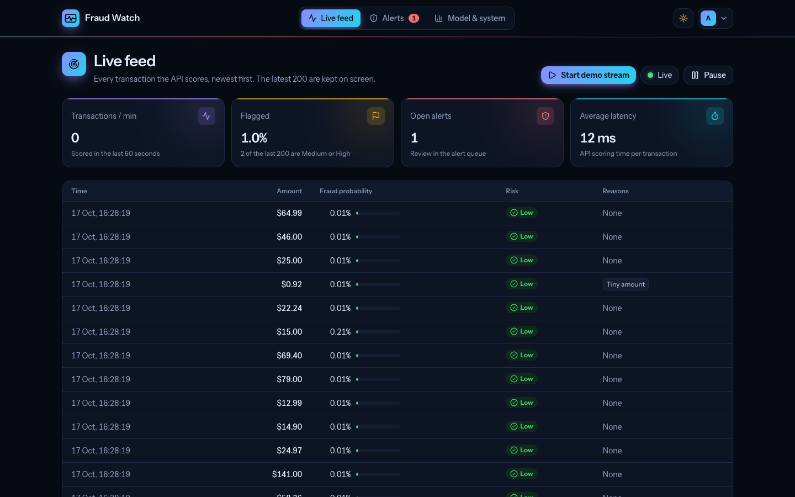
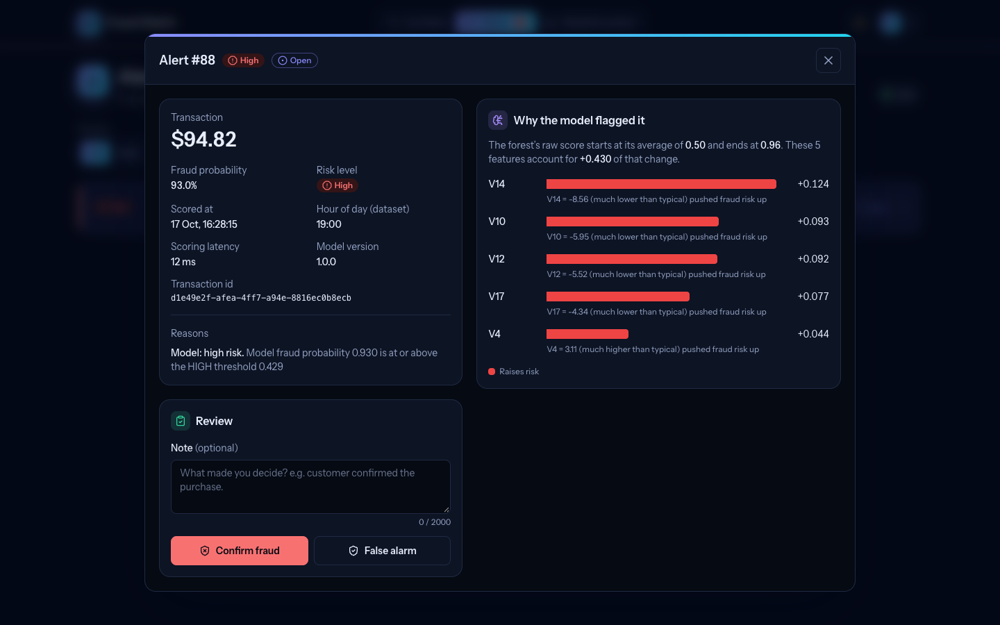
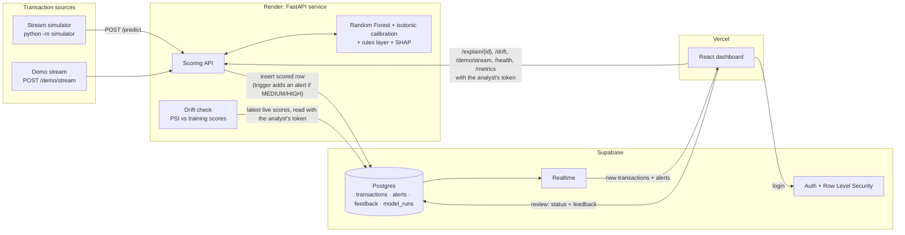
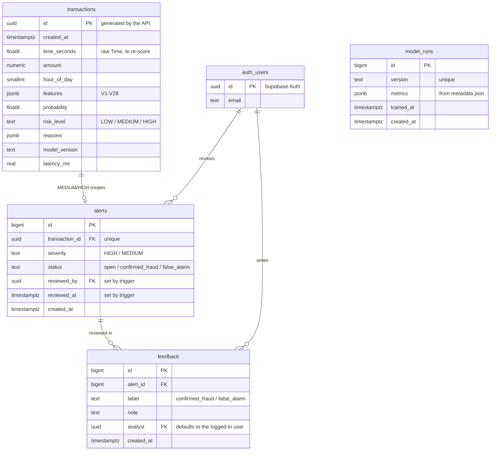
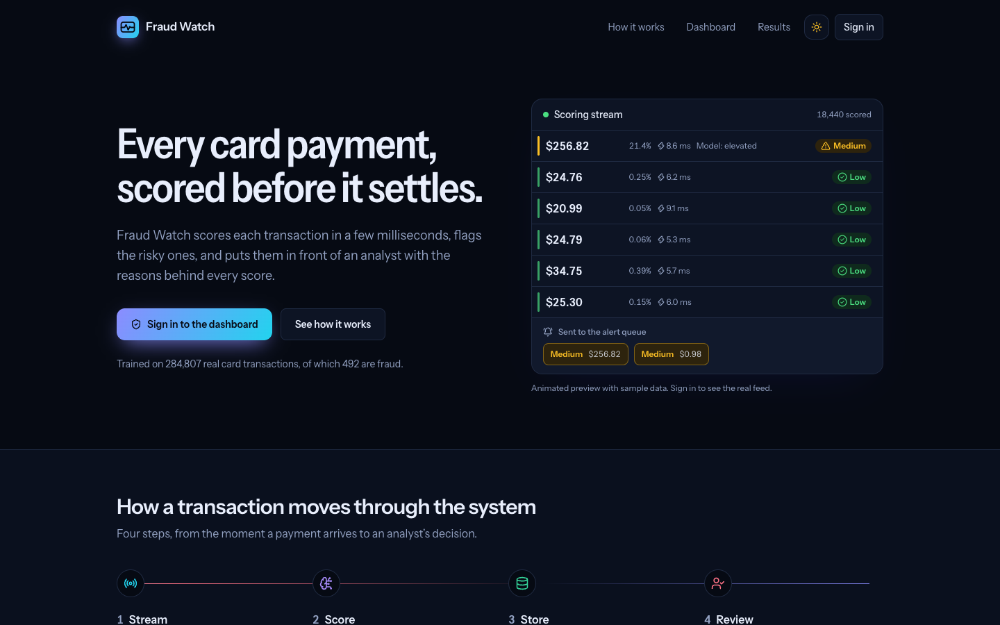
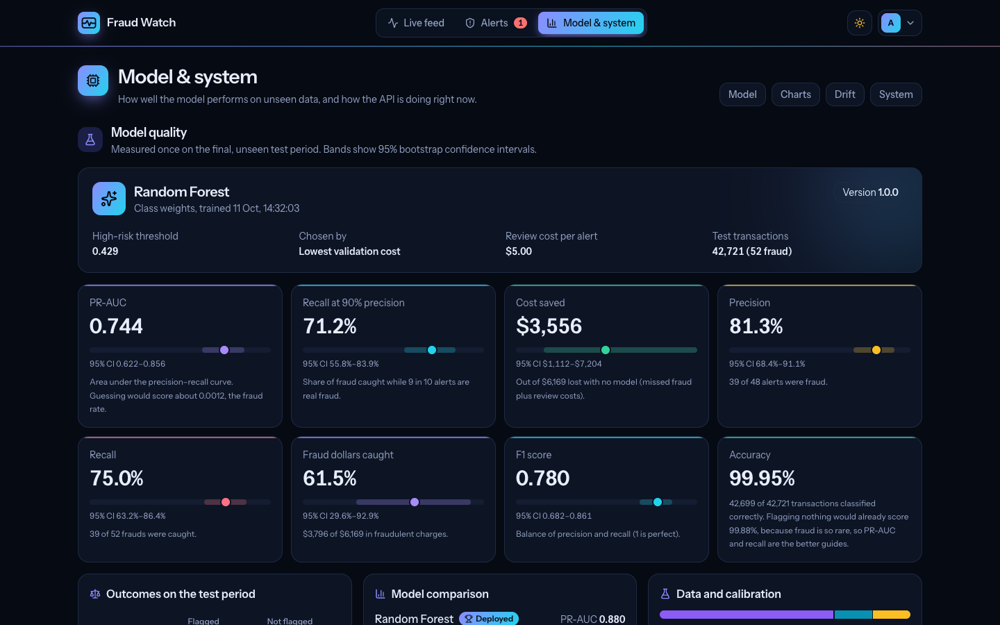
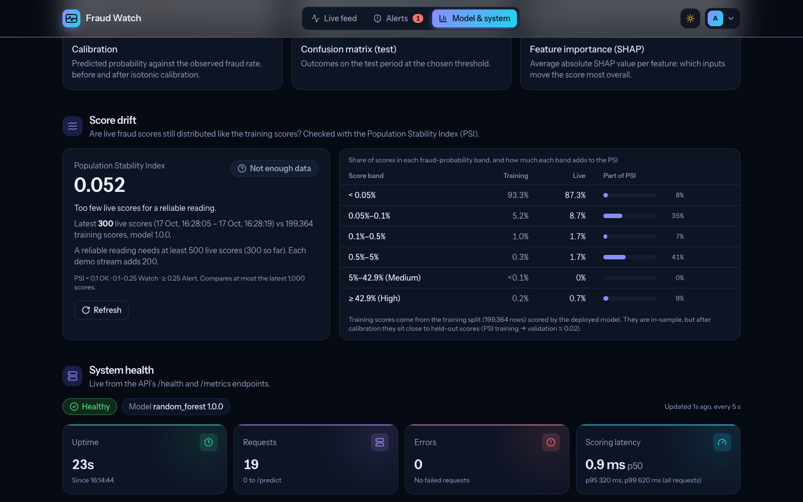

# Real-Time Fraud Detection & Risk Scoring

[](https://github.com/vid6848/fraud-detection/actions/workflows/ci.yml)
[](https://codecov.io/gh/vid6848/fraud-detection)


[](LICENSE)

An end-to-end fraud detection system: machine-learning models trained on 284,807 real credit card transactions, served through a low-latency FastAPI service, fed by a real-time transaction stream, stored in Supabase, and monitored from a live React analyst dashboard. Every transaction gets a fraud probability, a LOW / MEDIUM / HIGH risk level, and a SHAP explanation of *why* — and analysts can review alerts and send feedback, just like in a production fraud operations team.

## Live demo

| | |
|---|---|
| **Dashboard** | `https://<your-app>.vercel.app` *(link added after deployment)* |
| **API docs** | `https://<your-api>.onrender.com/docs` *(link added after deployment)* |
| **Analyst login** | Public sign-up is off; demo credentials on request |

The API runs on Render's free plan and sleeps when idle: the first visit can take about a minute while it wakes (the dashboard says so). Once signed in, click **Start demo stream** to replay 200 held-out test transactions through the model and watch them, and the alerts they raise, arrive live. How it's deployed: [`docs/deployment.md`](docs/deployment.md).

| Live feed | Alert detail with SHAP explanation |
|---|---|
|  |  |

## Features

**Machine learning**
- Time-based train / validation / test split (no data leakage from the future)
- Four models compared: Logistic Regression, Decision Tree, Random Forest, XGBoost
- Three imbalance strategies compared: class weights, SMOTE, undersampling (fraud is only 0.17% of data)
- Evaluated with metrics that matter for rare events: PR-AUC, precision, recall, F1, recall at 90% precision, and dollars saved — not accuracy
- Cost-based decision threshold (missed fraud vs. analyst review cost)
- Calibrated probabilities
- Per-transaction SHAP explanations

**API**
- FastAPI endpoints: `/predict`, `/predict/batch`, `/explain`, `/explain/{id}` (stored transactions, analysts only), `/health`, `/metrics` (p50/p95/p99 latency), `/demo/stream` (server-side replay for the deployed demo), `/drift` (score drift)
- Every scored transaction saved to Supabase in a background task (scoring keeps working if the database is down)
- Hybrid scoring: ML model + a small rules layer
- LOW / MEDIUM / HIGH risk levels; MEDIUM and HIGH automatically raise an alert

**Real-time pipeline**
- Stream simulator replays held-out test transactions at a fixed rate (e.g. 20/sec) or at their real time gaps sped up, with retries, a failing-API cut-off, a live terminal view and a JSON run report
- Every scored transaction stored in Supabase Postgres
- Supabase Realtime pushes new transactions and alerts to the dashboard instantly

**Analyst dashboard**
- Live transaction feed over Supabase Realtime, with pause/resume and live KPIs
- Alert review queue: confirm fraud or mark a false alarm, with a note (feedback loop), and a notification for every new alert
- Alert detail with SHAP feature-contribution bars from the API
- Model & system page: test metrics with confidence intervals, model comparison, training charts, score drift, and live API health and latency
- One-click demo stream, and a friendly "API is waking up" state for the free-tier API
- Secure analyst login (Supabase Auth + Row Level Security); dark and light themes; works on phones

**Production-ready**
- 376 pytest tests (98% coverage of `api/`, `simulator/`, `ml/`) + 308 dashboard tests, run by GitHub Actions on every PR, with coverage on Codecov
- Slim, non-root Docker image for the API, built and smoke-tested in CI
- Drift monitoring: Population Stability Index of live scores vs. the training distribution, labelled OK / Watch / Alert
- Deployment config for Render (API) and Vercel (dashboard), with a step-by-step [guide](docs/deployment.md)

## Architecture



- **Scoring path:** a transaction reaches the API, the model scores it in a few milliseconds, the rules layer can add reasons, and the response goes back at once; the row is saved to Supabase *after* the response, so storage never slows scoring.
- **Alerting:** a database trigger creates an alert for every MEDIUM/HIGH row, and Realtime pushes both to every open dashboard.
- **Security:** the browser only ever holds the Supabase publishable key and the analyst's login token, so Row Level Security decides what it may read or change. The secret key lives only on the API server.

## Tech stack

| Layer | Technologies |
|---|---|
| Machine learning | Python 3.13, pandas, scikit-learn, XGBoost, imbalanced-learn, SHAP |
| API | FastAPI, pytest |
| Database & auth | Supabase (Postgres, Realtime, Auth, Row Level Security) |
| Frontend | React, Vite, TypeScript, Tailwind CSS, Recharts |
| DevOps | Docker, GitHub Actions, Codecov, Render, Vercel |

## Folder structure

```
.
├── data/          # Kaggle dataset (not committed)
├── ml/            # EDA notebook and training pipeline
│   └── artifacts/ # trained model, threshold, metrics, PR curves
├── api/           # FastAPI scoring service
│   └── assets/    # 200 unlabelled test rows for POST /demo/stream
├── simulator/     # real-time transaction stream replayer
├── web/           # React analyst dashboard (vercel.json for deployment)
├── supabase/      # SQL migrations and RLS checks
├── scripts/       # load model results, demo rows, drift reference, reset demo data, benchmark
├── tests/         # pytest test suite
├── docs/          # EDA findings, model results, deployment guide, figures, screenshots
├── .github/       # CI workflow
├── Dockerfile     # production API image (Render)
└── render.yaml    # Render Blueprint
```

## Dataset

[Kaggle — Credit Card Fraud Detection (ULB)](https://www.kaggle.com/datasets/mlg-ulb/creditcardfraud): 284,807 European card transactions over two days, 492 of them fraudulent (0.17%). Features `V1`–`V28` are anonymized PCA components; `Time` and `Amount` are raw. Because the features are anonymized, the "real-time" stream is a replay of the held-out test period.

> Why not accuracy? A model that predicts "not fraud" for everything scores **99.83% accuracy** and catches zero fraud. This project reports PR-AUC, recall at fixed precision, and cost saved instead.

## Results

Full write-up: [`docs/model_results.md`](docs/model_results.md). Every choice (model, imbalance strategy, hyperparameters, calibration, threshold) was made on the validation set. The test set was scored **once** per model version (it was re-scored once more after fixing a calibration bug, not to tune anything; see the write-up).

**Final model: Random Forest + class weights, isotonic calibration. Held-out test set** (42,721 transactions, 52 frauds; threshold 0.429, chosen by business cost on validation; 95% bootstrap CIs):

| PR-AUC | Precision | Recall | F1 | Recall @ 90% precision | Fraud $ caught | Cost saved* |
|---|---|---|---|---|---|---|
| **0.744** (0.62–0.86) | **0.812** (0.68–0.91) | **0.750** (0.63–0.86) | **0.780** (0.68–0.86) | **0.712** (0.56–0.84) | **61.5%** (30–93%) | **$3,556** of $6,169 ($1.1k–$7.2k) |

\*Cost = missed fraud dollars + $5 per analyst review, compared with having no model. On test: 48 alerts, 39 real frauds caught, 9 false alarms, 13 frauds missed.

**Model comparison: validation set** (best imbalance strategy and hyperparameters for each model):

| Model | Best imbalance strategy | PR-AUC | Recall @ 90% precision |
|---|---|---|---|
| **Random Forest** ⭐ | Class weights | **0.880** | 0.80 |
| XGBoost | None | 0.864 | 0.82 |
| Logistic Regression | Class weights | 0.815 | 0.66 |
| Decision Tree | None | 0.778 | 0.71 |

SHAP sanity check passed: V17, V14, V12 and V10, the strongest fraud signals in the EDA, are all among the model's top 10 features. Caveat: the validation and test periods contain no night hours, so night-time performance is untested (see the write-up).

**API latency** (1,000 test rows over HTTP on localhost, Apple M2): `/predict` p50 **6.6 ms**, p95 **7.0 ms**, p99 **8.0 ms**; a 1,000-row `/predict/batch` takes **34 ms**. Details in [API → Benchmark](#benchmark).

## API

A FastAPI service in [`api/`](api/) that loads `ml/artifacts/model.joblib` once at startup and scores transactions in a few milliseconds.

### Run it

```bash
source .venv/bin/activate
uvicorn api.main:app --no-access-log          # add --reload while developing
# interactive docs: http://localhost:8000/docs
```

`--no-access-log` turns off uvicorn's plain-text access lines; the API writes its own structured JSON line for every request (see [Logging](#logging)). Settings come from `.env` (see `.env.example`): `MODEL_PATH`, `METADATA_PATH`, `MEDIUM_THRESHOLD` (default 0.05), `MAX_BATCH_SIZE` (default 1000), `LOG_LEVEL`, and for storage `SUPABASE_URL`, `SUPABASE_SERVICE_ROLE_KEY`, `SUPABASE_ANON_KEY`, `STORAGE_TIMEOUT_S` (default 5), `CORS_ORIGINS`, and the `DEMO_*` limits for the demo stream.

Or with Docker, as it runs on Render (a slim image with only the API's runtime dependencies from [`requirements-api.txt`](requirements-api.txt), running as a non-root user; `PORT` is read from the environment):

```bash
docker build -t fraud-api .
docker run -p 8000:8000 --env-file .env fraud-api
```

| Method | Path | What it does |
|---|---|---|
| GET | `/health` | Is the model loaded, and which version |
| POST | `/predict` | Score one transaction: probability, risk level, reasons |
| POST | `/predict/batch` | Score 1–1,000 transactions in one vectorized model call |
| POST | `/explain` | Score + top 5 SHAP feature contributions in plain words |
| GET | `/explain/{id}` | Same explanation for a **stored** transaction; needs an analyst login token |
| GET | `/metrics` | Request counts, p50/p95/p99 latency, errors, risk-level counts, uptime |
| POST | `/demo/stream` | Analysts only: replay up to 200 held-out test rows server-side at ~10/s (for the deployed demo) |
| GET | `/demo/stream` | Progress of the current or last demo stream |
| GET | `/drift` | Analysts only: PSI between the latest live scores and the training score distribution, with an OK / Watch / Alert label |

A transaction is one row of `creditcard.csv` without `Class`: `Time`, `V1`–`V28`, `Amount` (all numbers; `Time` and `Amount` ≥ 0; unknown fields are rejected). The examples below use [`docs/examples/transaction.json`](docs/examples/transaction.json), a real fraud from the validation period.

### Risk levels

| Level | Rule |
|---|---|
| **HIGH** | Model probability **≥ 0.429**: the cost-optimal threshold tuned on validation in Phase 2 (`metadata.json["threshold"]`). Only the model can produce HIGH. |
| **MEDIUM** | Probability ≥ **0.05**, *or* a LOW transaction that trips **both** rules below |
| **LOW** | Everything else |

**Why 0.05 for MEDIUM?** The calibrated scores are step-like, so the cut was read off the validation set: at ≥ 0.05 there are 18 extra transactions (0.04% of traffic) holding 4 of the 11 frauds HIGH misses, a 22% fraud rate. Going down to 0.01 would add 177 more rows for just 2 more frauds.

**Rules layer** (from the [EDA](docs/eda_findings.md)). Rules always add a reason code; they can raise LOW to MEDIUM only when both fire, and never create HIGH:

| Code | Fires when | Why |
|---|---|---|
| `TINY_AMOUNT` | `Amount` < $1.00 | 5.5% of frauds are $0.00 "card testing" charges vs 0.6% of normal ones (finding 4) |
| `NIGHT_HOURS` | hour of day in [01:00, 07:00) | fraud rate is 1.0–1.7% at night vs ~0.1–0.2% by day (finding 5) |
| `RULES_ESCALATED` | both of the above on a LOW transaction | raises it to MEDIUM |

Model reasons are `MODEL_HIGH_RISK` and `MODEL_MEDIUM_RISK`. On the validation set: LOW 42,654 (7 frauds), MEDIUM 18 (4), HIGH 50 (45). Honest caveats: the model already sees amount and hour, so the rules mostly explain rather than add signal; and validation/test contain no night hours, so on validation `NIGHT_HOURS` never fires. On the training period (which has nights) the escalation rule would add about 0.6% of traffic to MEDIUM at a 0.95% fraud rate.

### Storage

With the three `SUPABASE_*` variables set, every transaction scored by `/predict` and `/predict/batch` is saved to the `transactions` table (see [Database](#database)), and MEDIUM/HIGH ones get an alert:

- **After the response, not before.** The API gives each row a `transaction_id` (UUID) and returns it straight away; a FastAPI background task inserts the rows once the response has been sent (one insert per request, so a 1,000-row batch is one call).
- **Failures never fail scoring.** If Supabase is down or slow (timeout `STORAGE_TIMEOUT_S`), the client still gets its score; the API logs `storage write failed` (error type and code only, never row values) and counts it in `/metrics` → `storage`.
- **Keys stay on the server.** Writes use the service role key, which bypasses Row Level Security. It is read from `.env` only, never logged (it's even hidden from `repr(Settings)`), and must never reach the dashboard.
- Without the variables, storage is off: scoring works the same, `transaction_id` is `null`, and `GET /explain/{id}` answers 503.

### Endpoints

**`GET /health`**

```bash
curl localhost:8000/health
```
```json
{"status": "ok", "model_loaded": true, "model_version": "1.0.0",
 "model_name": "random_forest", "trained_at": "2026-10-11T09:02:03+00:00"}
```
Returns 503 `{"status": "unavailable", "model_loaded": false}` until the model has loaded.

**`POST /predict`**

```bash
curl -X POST localhost:8000/predict \
  -H "Content-Type: application/json" \
  -d @docs/examples/transaction.json
```
```json
{
  "probability": 0.9257142857142857,
  "risk_level": "HIGH",
  "reasons": [
    {"code": "MODEL_HIGH_RISK",
     "message": "Model fraud probability 0.926 is at or above the HIGH threshold 0.429"}
  ],
  "transaction_id": "5b0c6f1e-2f43-4f7e-9a51-0c8d7f2e9b14",
  "model_version": "1.0.0",
  "latency_ms": 5.893
}
```
`latency_ms` is server-side time for this request (the first request after startup is slower, ~20 ms). A $0.00 charge at 03:00 that the model rates LOW (0.0001) instead comes back `MEDIUM` with reasons `TINY_AMOUNT`, `NIGHT_HOURS`, `RULES_ESCALATED`.

**`POST /predict/batch`**: up to `MAX_BATCH_SIZE` (1,000) rows, scored in one model call; results come back in input order.

```bash
curl -X POST localhost:8000/predict/batch \
  -H "Content-Type: application/json" \
  -d @docs/examples/batch.json            # {"transactions": [ {...}, {...} ]}
```
```json
{
  "results": [
    {"probability": 0.9257142857142857, "risk_level": "HIGH",
     "reasons": [{"code": "MODEL_HIGH_RISK", "message": "Model fraud probability 0.926 is at or above the HIGH threshold 0.429"}],
     "transaction_id": "0f4b8a52-91d6-4c1e-8a0e-6c2f5d9b7a31"},
    {"probability": 0.00013366799839598402, "risk_level": "LOW", "reasons": [],
     "transaction_id": "c3e1d7a4-5b2f-4e8c-9d06-1a7b3f5e2c90"}
  ],
  "count": 2,
  "model_version": "1.0.0",
  "latency_ms": 6.156
}
```

**`POST /explain`**: the `/predict` response plus the 5 inputs that moved the score most (SHAP). `log_amount` is reported as `Amount` and the two hour features as `time_of_day`. "Typical" compares the value with the training data (within 1 standard deviation = close to typical, beyond 2 = much higher/lower).

```bash
curl -X POST localhost:8000/explain \
  -H "Content-Type: application/json" \
  -d @docs/examples/transaction.json
```
```json
{
  "probability": 0.9257142857142857,
  "risk_level": "HIGH",
  "reasons": [{"code": "MODEL_HIGH_RISK", "message": "Model fraud probability 0.926 is at or above the HIGH threshold 0.429"}],
  "model_version": "1.0.0",
  "latency_ms": 11.829,
  "model_score": 0.7388427961002015,
  "base_value": 0.4999999999999627,
  "top_features": [
    {"feature": "V14", "value": -4.799737, "shap_value": 0.1343, "direction": "raises_risk",
     "description": "V14 = -4.80 (much lower than typical) pushed fraud risk up"},
    {"feature": "V10", "value": -3.739659, "shap_value": 0.1021, "direction": "raises_risk",
     "description": "V10 = -3.74 (much lower than typical) pushed fraud risk up"},
    {"feature": "V17", "value": -3.166955, "shap_value": 0.0886, "direction": "raises_risk",
     "description": "V17 = -3.17 (much lower than typical) pushed fraud risk up"},
    {"feature": "V12", "value": -2.844449, "shap_value": 0.0756, "direction": "raises_risk",
     "description": "V12 = -2.84 (much lower than typical) pushed fraud risk up"},
    {"feature": "V7", "value": 1.017732, "shap_value": -0.0648, "direction": "lowers_risk",
     "description": "V7 = 1.02 (close to typical) pushed fraud risk down"}
  ]
}
```
SHAP explains `model_score`, the forest's uncalibrated score (`base_value` + all SHAP values = `model_score`). `probability` is a monotonic calibration of that score, so the features that push one up push the other up too. shap_values are rounded here for readability.

**`GET /explain/{id}`**: the `/explain` response for a transaction saved earlier, plus `transaction_id`, `created_at`, `stored_probability` and `stored_model_version` (what it scored when it arrived; `probability` is recomputed with the current model). Only for logged-in analysts: send the Supabase access token of an analyst session. The API reads the row **with that token** (anon key + user JWT), so Row Level Security decides, exactly as for the dashboard.

```bash
curl localhost:8000/explain/5b0c6f1e-2f43-4f7e-9a51-0c8d7f2e9b14 \
  -H "Authorization: Bearer $ANALYST_ACCESS_TOKEN"
```
No token or an invalid/expired one → 401; unknown id (or one RLS hides) → 404; storage off or unreachable → 503; not a UUID → 422.

**`GET /metrics`**

```bash
curl localhost:8000/metrics
```
```json
{
  "uptime_seconds": 0.527,
  "started_at": "2026-10-11T10:05:59+00:00",
  "requests": {"total": 8, "by_endpoint": {"GET /health": 2, "POST /explain": 1, "POST /predict": 3,
                                           "POST /predict/batch": 1, "unmatched": 1}},
  "errors": {"total": 2, "by_status": {"404": 1, "422": 1}},
  "latency_ms": {"count": 8, "p50": 4.077, "p95": 18.082, "p99": 20.464, "window": 10000,
                 "by_endpoint": {"POST /predict": {"count": 3, "p50": 7.155, "p95": 19.669, "p99": 20.781}, "...": {}}},
  "risk_levels": {"LOW": 1, "MEDIUM": 0, "HIGH": 3},
  "storage": {"enabled": true, "writes_ok": 4, "writes_failed": 0, "rows_written": 5, "rows_failed": 0},
  "scope": "in-memory, per worker process, reset on restart"
}
```
Latency percentiles cover the most recent 10,000 requests. `risk_levels` counts transactions scored by `/predict`, `/predict/batch` and the demo stream (not `/explain` or `/explain/{id}`). `storage` counts background inserts (one per request) and the rows in them; a non-zero `writes_failed` means scored transactions were not saved. These numbers live in memory: they reset on restart, and each uvicorn worker reports its own.

**`POST /demo/stream`** *(analysts only)*

The deployed demo has no simulator running, so a logged-in analyst can start a short stream from the dashboard. The API replays [`api/assets/demo_rows.csv.gz`](api/assets/demo_rows.csv.gz): 200 consecutive rows of the held-out **test** split (4 of them fraud, starting at test offset 9740), **without** the `Class` column, made by `python scripts/make_demo_rows.py`. Each row is scored and saved exactly like a `/predict` call, so it appears in the live feed and MEDIUM/HIGH rows raise alerts.

```bash
curl -X POST localhost:8000/demo/stream \
  -H "Authorization: Bearer $ACCESS_TOKEN" \
  -H "Content-Type: application/json" -d '{"limit": 50}'    # body optional; default 200
```
```json
{"running": true, "max_rows": 200,
 "run": {"id": "9f0c...", "state": "running", "total": 50, "sent": 0, "failed": 0,
         "rate_per_s": 10.0, "started_at": "2026-10-18T09:40:00+00:00", "finished_at": null}}
```
Returns 202 at once; `GET /demo/stream` shows progress (`state`: `running`, `completed`, `failed` after 5 failed rows in a row, `cancelled` on shutdown). Guard rails, since it writes to the shared database:

| Rule | Response | Setting (default) |
|---|---|---|
| Login token checked with Supabase Auth | 401 if missing or invalid | |
| One stream at a time | 409 | |
| Each analyst once per minute | 429 + `Retry-After` | `DEMO_COOLDOWN_S` (60) |
| All analysts together per rolling hour | 429 + `Retry-After` | `DEMO_MAX_PER_HOUR` (12) |
| Rows per stream, speed | 422 if `limit` < 1; larger values are capped | `DEMO_MAX_ROWS` (200), `DEMO_RATE_PER_S` (10) |

Without storage configured it returns 503. The lock and limits are in memory, which is why the API runs as a single worker.

**`GET /drift`** *(analysts only)*

Is the model still seeing the kind of transactions it was trained on? The API reads the newest scores from Supabase **with the caller's login** (so Row Level Security applies), only from the model version it is serving, and compares their distribution with the training split's using the **Population Stability Index**:

PSI = Σ over bins of (live% − training%) × ln(live% ÷ training%)

```bash
curl localhost:8000/drift -H "Authorization: Bearer $ACCESS_TOKEN"
```
```json
{"status": "OK", "psi": 0.052426, "live_rows": 300, "window": 1000, "min_rows": 500,
 "thresholds": {"watch": 0.1, "alert": 0.25},
 "bins": [{"lower": 0.0, "upper": 0.0005, "reference": 0.93295, "live": 0.87333, "contribution": 0.00395}, "..."],
 "reference": {"rows": 199364, "source": "training split (199,364 rows) scored by the deployed model", "...": "..."}}
```
*(This example was run with `DRIFT_MIN_ROWS=100`; with the default of 500, 300 rows give `"Not enough data"`.)*

| Decision | Choice | Why |
|---|---|---|
| Labels | PSI < 0.1 **OK**, 0.1–0.25 **Watch**, ≥ 0.25 **Alert** | The usual rule of thumb |
| Bins | < 0.05%, 0.05–0.1%, 0.1–0.5%, 0.5–5% (all LOW), 5–42.9% (MEDIUM), ≥ 42.9% (HIGH) | The calibrated score is step-like (93% of training scores are under 0.05%), so quantile bins would collapse; these follow the risk bands |
| Window | The latest 1,000 live scores; under 500 gives **Not enough data** | Small windows are noisy. Replaying the held-out test period (no real drift) in 1,000-row windows never reached Alert and reached Watch 4.8% of the time; 200-row windows did 2% and 11% |
| Reference | The training split scored by the deployed model, saved by `python scripts/make_score_distribution.py` to [`ml/artifacts/score_distribution.json`](ml/artifacts/score_distribution.json) | In-sample, but calibration keeps it close to held-out scores (PSI training → validation 0.02). The API ignores a reference made for another model version (re-run the script after retraining) |
| Empty bins | Counted as 0.01% instead of 0 | Keeps ln(·) finite |

Settings: `DRIFT_WINDOW` (1000), `DRIFT_MIN_ROWS` (500), `SCORE_DISTRIBUTION_PATH`. Returns 503 without storage or without a matching reference. The dashboard shows it on the Model & System page (**Score drift**): the PSI, its label, and each band's share of training vs live scores and of the PSI.

### Errors

Every error has the same shape, and `request_id` matches the `X-Request-ID` response header and the server log line:

```json
{"error": {"code": "validation_error", "message": "Request body failed validation",
           "request_id": "edf4bf301f4e42a3a4424b99b970ba4e",
           "details": [{"loc": ["body", "Amount"],
                        "message": "Input should be greater than or equal to 0",
                        "type": "greater_than_equal"}]}}
```

| Status | `code` | When |
|---|---|---|
| 422 | `validation_error` | Missing/extra field, wrong type, negative amount, NaN, malformed JSON, batch empty or over 1,000. `details` names each bad field but never echoes the submitted values. |
| 401 | `unauthorized` | `GET /explain/{id}`, `GET /drift` or `POST /demo/stream` without a valid analyst token |
| 404 | `not_found` | Unknown path, or a stored transaction that doesn't exist |
| 405 | `method_not_allowed` | e.g. `GET /predict` |
| 409 | `conflict` | `POST /demo/stream` while a demo stream is running |
| 429 | `rate_limited` | `POST /demo/stream` started too recently; wait `Retry-After` seconds |
| 503 | `service_unavailable` | Model not loaded yet, or (for `GET /explain/{id}` and `/demo/stream`) storage off or unreachable |
| 500 | `internal_error` | Unexpected bug: the client only gets "Internal server error"; the stack trace goes to the server log under the same request ID |

### Logging

One JSON line per request on stderr, with a request ID (send your own `X-Request-ID` to trace a call end to end, or one is generated). Transaction values are never logged: only an allow-list of fields is written.

```json
{"ts": "2026-10-11T10:06:57.325+00:00", "level": "INFO", "logger": "api", "message": "request",
 "request_id": "demo-123", "method": "POST", "endpoint": "POST /predict", "path": "/predict",
 "status": 200, "latency_ms": 6.47, "risk_level": "HIGH"}
```
4xx responses log at WARNING (with `error_code` and the names of invalid fields), 5xx at ERROR with the traceback.

### Benchmark

[`scripts/benchmark_api.py`](scripts/benchmark_api.py) starts uvicorn, then sends the first 1,000 **test-split** rows to `/predict` one at a time over one keep-alive HTTP connection (like the stream simulator will), and posts the same 1,000 rows to `/predict/batch` 20 times. Needs `data/creditcard.csv`.

```bash
python scripts/benchmark_api.py              # or --url http://localhost:8000 for a running server
```

Apple M2, Python 3.13, localhost, single uvicorn worker:

| | p50 | p95 | p99 | Throughput |
|---|---|---|---|---|
| `/predict`, round-trip (1,000 sequential requests) | 6.57 ms | 7.04 ms | 7.96 ms | 149 requests/s from one client |
| `/predict`, server-side | 5.62 ms | 6.00 ms | 6.97 ms | |
| `/predict/batch`, 1,000 rows, round-trip | 33.7 ms | 34.3 ms | 34.4 ms | ~29,700 rows/s |
| `/predict/batch`, 1,000 rows, server-side | 15.7 ms | 16.1 ms | 16.1 ms | |

**With Supabase storage on** (same machine, same day, 5 batch runs; storage off measured alongside for a fair comparison):

| p50, round-trip | storage off | storage on |
|---|---|---|
| `/predict` | 6.6 ms | 8.7 ms |
| `/predict/batch`, 1,000 rows | 33.7 ms | 48.8 ms |

The ~100 ms network insert never sits in front of a response (otherwise `/predict` would be ~100 ms). The extra 2 ms comes from the previous request's background task (building and JSON-encoding the rows) sharing the CPU with the next request; for batches that's 1,000 rows of JSON. All 7,020 benchmark rows were written with no failures (and deleted afterwards).

`/explain` adds about 6 ms of SHAP on top of scoring (p50 11.6 ms server-side). Most of the gap between server-side and round-trip on the batch is parsing and validating 1,000 JSON rows. One design choice behind these numbers: the forest was saved with `n_jobs=-1`, and starting a thread pool for a single row cost ~10 ms, so the API scores with one thread (same predictions, `/predict` went from 15 ms to 6 ms).

## Database

Supabase (Postgres) stores every scored transaction, the alert queue, analyst feedback and model versions. The schema lives in [`supabase/migrations/`](supabase/migrations/) as plain SQL, applied in filename order.



**Logic in the database, not the API:**
- **Alerts:** a trigger on `transactions` inserts an alert for every MEDIUM or HIGH row in the same database transaction, so a risky transaction can never be stored without its alert (and the API makes one insert per request).
- **Review stamp:** when an analyst changes `alerts.status`, a trigger sets `reviewed_by` to their user id and `reviewed_at` to now, so neither can be faked.
- **Indexes:** for the live feed (`transactions.created_at`), risk filters (`risk_level, created_at`), the review queue (`alerts.status, created_at`), and every foreign key.
- **Realtime:** inserts and updates on `transactions` and `alerts` stream to the dashboard. Realtime applies the same RLS rules, so only logged-in analysts receive events.

### Row Level Security

RLS is on for all four tables. Access is set in two layers: grants decide which actions a role may try at all (down to single columns), and policies decide which rows those actions may touch.

| Who | `transactions` | `alerts` | `feedback` | `model_runs` |
|---|---|---|---|---|
| **anon** (not logged in) | nothing | nothing | nothing | nothing |
| **authenticated** (analyst) | read | read; update `status` only | read; insert as themselves | read |
| **service_role** (API, scripts) | insert, read | (via trigger) | — | upsert |

- The **service role key bypasses RLS**, so it's server-side only: the API and `scripts/` read it from `.env`. It is never committed or logged, and must never be used in `web/` (the dashboard uses the anon key plus the analyst's login).
- An **analyst** is any logged-in user. Public sign-ups are turned off, so only accounts created in the dashboard can log in.
- **Proof:** [`supabase/tests/rls_checks.sql`](supabase/tests/rls_checks.sql) tries every allowed and forbidden action as `anon` and as an analyst inside one rolled-back transaction, and fails loudly on any breach. [`tests/test_rls_integration.py`](tests/test_rls_integration.py) checks the same rules over HTTP with the real anon key and demo analyst login.

### Set up your own project

1. **Create a Supabase project** and copy the project URL, anon key and service role key (Project Settings → API) into `.env` (see `.env.example`).
2. **Apply the migrations** in [`supabase/migrations/`](supabase/migrations/) in filename order: paste each one into the SQL editor, or run `supabase db push` with the Supabase CLI.
3. **Check RLS:** run [`supabase/tests/rls_checks.sql`](supabase/tests/rls_checks.sql) in the SQL editor. It should print `ALL RLS CHECKS PASSED` and leave nothing behind.
4. **Auth:** Authentication → Sign In / Providers → Email: keep Email enabled and turn off "Allow new users to sign up". Then Authentication → Users → Add user → Create new user (tick "Auto Confirm User") for each analyst. Put a demo analyst's email and password in `.env` as `DEMO_ANALYST_EMAIL` / `DEMO_ANALYST_PASSWORD` for the integration tests.
5. **Load the model's results:** `python scripts/load_model_runs.py` (safe to re-run; it updates the row for the same version).
6. **Start the API** and score something: the transaction appears in `transactions`, and an alert appears in `alerts` if it's MEDIUM/HIGH.
7. **Run the integration tests:** `pytest -m integration`. They're skipped automatically when credentials are missing, and clean up the rows they create.

## Simulator

The features are anonymized, so "real time" means replaying the held-out **test split** (the last ~6 hours of the dataset, which the model never saw) through the API, oldest transaction first. [`simulator/`](simulator/) does that, and the scored transactions land in Supabase exactly as live traffic would.

**The label never reaches the API.** Each request contains only `Time`, `V1`–`V28` and `Amount` (a test checks this). The simulator keeps `Class` on your machine and only uses it at the end, to count how many frauds the API caught and missed.

### Run it (two terminals)

```bash
# terminal 1: the API (saves to Supabase if the SUPABASE_* variables are set)
source .venv/bin/activate
uvicorn api.main:app --no-access-log

# terminal 2: the stream
source .venv/bin/activate
python -m simulator                              # 20 rows/s through the whole test split (~36 min)
python -m simulator --limit 300                  # first 300 test rows (15 s)
python -m simulator --offset 9600 --limit 300    # a 300-row window with 4 labelled frauds
python -m simulator --mode replay --speed 10     # real gaps between transactions, 10x faster
python -m simulator --batch 50 --rate 200        # 50 rows per POST /predict/batch
```

The simulator checks `GET /health` first and exits with a clear message if the API isn't running. **Ctrl+C** stops it gracefully: no new requests, in-flight ones get up to 5 s to finish, then the summary prints and the report is saved.

| Option | Default | What it does |
|---|---|---|
| `--rate` | 20 | Rows per second (fixed mode) |
| `--mode` | `fixed` | `fixed` = steady `--rate`; `replay` = the real gaps between the dataset's `Time` values, divided by `--speed` |
| `--speed` | 10 | Replay speed-up. The test period averages ~2 transactions per real second, so ×10 is ~20/s |
| `--limit` / `--offset` | all / 0 | How many test rows to send, and which row to start from |
| `--api-url` | `API_URL` in `.env` | API base URL (falls back to `http://localhost:8000`) |
| `--concurrency` | 10 | Max requests in flight |
| `--batch` | 1 | Rows per request; above 1 uses `POST /predict/batch` (max 1,000). The rate stays rows per second |
| `--retries` | 3 | Retries for connection errors, timeouts and 5xx |
| `--max-error-rate` | 0.2 | Stop if more than this share of the last 100 requests failed |
| `--timeout` | 10 | Seconds per request |
| `--report-dir` / `--no-live` | `simulator/reports/` / off | Where the JSON report goes; turn off the live view |

**Pacing is fixed in advance.** Row *n* is due at *n* / rate seconds (or at its replayed time). A slow response doesn't push later sends back, so the API really gets the rate you asked for. If `--concurrency` requests are already waiting, the run falls behind and the report shows the lower actual rate.

**Request IDs.** Every request carries `X-Request-ID: sim-<run>-<row>` (`sim-<run>-b<first row>` for batches), so a row can be traced from the simulator to the API's JSON log line.

### Example run

The end-to-end check for this phase was the API with Supabase storage on, plus `python -m simulator --offset 9600 --limit 300`. While it runs, the terminal redraws this block in place (frozen here at the end of the run):

```
sent 300/300  ok 300  errors 0  retries 0  |  20.0 rows/s  |  15s
latency (last 300)  p50 14.2 ms  p95 15.7 ms
risk     LOW 298  MEDIUM 0  HIGH 2
frauds   caught HIGH 2  caught MEDIUM 0  missed 2  |  false alarms 0
failed requests  none
```

When it finishes:

```
== run 20261017-162804-c0e7 completed after 15.0s ==
rows      sent 300 of 300  ok 300  errors 0  retries 0  (20.0 rows/s, 300 requests)
latency   round trip p50 14.2 ms  p95 15.7 ms  p99 19.8 ms  |  server p50 11.6 ms
risk      LOW 298  MEDIUM 0  HIGH 2
frauds    4 sent: caught HIGH 2, caught MEDIUM 0, missed 2
quality   recall HIGH 50.0%  HIGH+MEDIUM 50.0%  |  precision HIGH 100.0%  flagged 100.0%  |  false alarms 0
report    simulator/reports/run-20261017-162804-c0e7.json
```

Supabase matched this exactly: 300 new rows in `transactions` (298 LOW, 2 HIGH) and 2 open alerts. The 2 missed frauds scored LOW. That's a small sample (the model's recall on the whole test set is 75%), but it's what happened. These rows are left in place as demo data for the dashboard.

### What the report means

When output goes to a file or pipe instead of a terminal, the live block becomes one progress line every 5 s. The JSON report (`simulator/reports/run-<id>.json`, gitignored) holds everything below, plus the settings used:

| Field | Meaning |
|---|---|
| `stopped_reason` | `completed`, `interrupted` (Ctrl+C, exit code 130) or `error_rate` (gave up on a failing API, exit code 3) |
| `rows` | Rows planned, sent, scored (`ok`), failed, never sent (stopped early), and cancelled in flight |
| `requests` | HTTP requests sent and failed. Same as rows unless `--batch` is used |
| `actual_rate_per_s` | Rows sent per second, measured |
| `retries`, `errors_by_kind` | Extra attempts made, and failed requests by kind (`http_422`, `ConnectError`, `bad_response`, ...) |
| `latency_ms` | p50/p95/p99 per request: `client_round_trip` (what a caller waits) and `server` (the API's own `latency_ms`) |
| `risk_levels`, `bands` | Rows per risk level; `bands` splits each level into fraud and legit using the local labels |
| `frauds` | Labelled frauds sent: `caught_high`, `caught_medium`, `missed_low` (scored LOW) and `not_scored` (their request failed) |
| `recall_high`, `recall_high_or_medium` | Share of the scored frauds that were flagged HIGH, or HIGH or MEDIUM |
| `precision_high`, `precision_flagged`, `false_alarms` | Share of HIGH (or MEDIUM+HIGH) rows that really were fraud; legit rows flagged (each one costs an analyst review) |

These are honest per-run numbers on whatever slice you replay. A short run sees only a handful of frauds, so expect them to swing; the model's real test-set metrics are in [Results](#results).

### When the API misbehaves

- **Retries.** Connection errors, timeouts and 5xx are retried with exponential backoff (about 0.25 s, 0.5 s, 1 s, each ±20% jitter), and a retry keeps its request ID. **4xx is never retried**: a 422 means the request itself is wrong, so sending it again can't help. It's counted and the run moves on.
- **Failing-API cut-off.** If more than `--max-error-rate` of the last 100 requests failed (checked once 20 have finished), the run stops instead of hammering a broken API. It still writes the summary and report. Tested for real by killing the API mid-run: 30 requests failed after 3 retries each, and the run stopped with exit code 3.
- **Malformed responses.** A 200 with an unexpected body is counted as `bad_response`, never silently dropped.

### Reset the demo data

```bash
python scripts/reset_demo_data.py         # shows the counts, asks you to type "yes"
python scripts/reset_demo_data.py --yes   # no prompt
```

It deletes every row in `transactions`, and their alerts and feedback go with them. `model_runs` is kept. It uses the service role key from `.env`, so it only runs server-side.

## Dashboard

[`web/`](web/) is the analyst dashboard: React 19, TypeScript, Vite, Tailwind CSS v4 and React Router, with Recharts for the live latency chart. It talks to two things:

- **Supabase**, directly from the browser, with the **publishable key** and the analyst's login token. Row Level Security decides what the analyst can read and change (read everything, change only `alerts.status`, add their own `feedback`). The secret / service-role key is never used in `web/`; a test fails if one appears there.
- **The API**, for `GET /explain/{id}` and `POST /demo/stream` (sent with the analyst's token), `/health` and `/metrics`. The API only accepts browser calls from the origins in `CORS_ORIGINS` (default `http://localhost:5180`).

| Page | What it shows |
|---|---|
| `/` | Public landing page: an animated sample scoring stream (clearly labelled as sample data), how the pipeline works, and the real test-set results |
| `/login` | Email + password sign-in for analysts (public sign-up is off) |
| `/app` | **Live feed.** The newest 200 scored transactions, arriving in real time. KPIs: transactions per minute, % flagged, open alerts, average latency. Pause / resume. **Start demo stream** replays 200 held-out test transactions through the API (about 20 s) with a progress bar |
| `/app/alerts` | **Alert queue.** Open alerts, High first then newest, filterable by severity and status. Click one for its details, the SHAP explanation from the API, and **Confirm fraud** / **False alarm** with an optional note |
| `/app/model` | **Model & system.** Test metrics with 95% confidence intervals, confusion matrix, model comparison, the Phase 2 charts, **score drift** (PSI vs training, OK / Watch / Alert), and live API health (polled every 5 s): uptime, errors, p50/p95 latency over time |

**When the API is asleep.** The deployed API runs on Render's free plan, which sleeps after 15 minutes without traffic and takes about a minute to wake. The dashboard pings `/health` as soon as the page loads, so the API starts waking while you log in. If `/health` is slow (over 3 s) or failing, every dashboard page shows *"API is waking up (free tier, ~1 min)"* with a timer and keeps retrying; after 2 minutes it switches to *"Can't reach the API"* with a Retry button. The live feed and alerts keep working meanwhile, because they come straight from Supabase. Against a local API there is no cold start, so a failure shows as "Can't reach the API" at once.

How a review is saved: the alert's status changes only if it's still open (so two analysts can't review it twice), then a `feedback` row records the verdict and note. A database trigger stamps who reviewed it and when. If only the feedback step fails, the dashboard offers to retry just that step.

### Run all three pieces

The dev server uses port **5180** (not Vite's usual 5173). It refuses to start on a different port, because the API's CORS setting expects 5180.

```bash
# one-time setup
cd web && npm install && cp .env.example .env
# fill in web/.env: VITE_SUPABASE_URL, VITE_SUPABASE_PUBLISHABLE_KEY (Supabase -> Project Settings -> API), VITE_API_URL
```

```bash
# terminal 1: the API (saves to Supabase when the SUPABASE_* variables are set in .env)
uvicorn api.main:app --no-access-log

# terminal 2: the dashboard -> http://localhost:5180
cd web && npm run dev

# terminal 3: the stream (watch rows and alerts arrive live in the dashboard)
python -m simulator --rate 20
```

Sign in with the demo analyst (`DEMO_ANALYST_EMAIL` / `DEMO_ANALYST_PASSWORD` in `.env`). Serving the dashboard from another address? Add it to `CORS_ORIGINS` in the root `.env`, comma-separated.

```bash
cd web
npm test            # Vitest + React Testing Library (no network: Supabase and fetch are faked)
npm run typecheck   # tsc
npm run lint        # ESLint, including jsx-a11y accessibility rules
npm run build       # production build in web/dist
```

### Deploy to Vercel

[`web/vercel.json`](web/vercel.json) has everything Vercel needs: a Vite build into `dist/`, a rewrite that sends every path to `index.html` (so deep links like `/app/alerts` and page refreshes work with React Router), a one-year cache for the hashed files in `/assets/`, and a few security headers. In Vercel set **Root Directory** to `web` and add the three `VITE_*` variables under **Settings → Environment Variables**. Vite builds them into the page, so **redeploy** after changing them; without them the site shows a "Configuration missing" page listing what to add. Then add the Vercel URL to the API's `CORS_ORIGINS`. Full walkthrough: Phase 7 step 5.

### Accessibility

Every page was checked with axe-core (WCAG 2.1 A/AA) in both themes, at laptop and phone widths, and is clean. Text meets 4.5:1 contrast in both themes. Risk and status are always shown as words, never colour alone. Everything works from the keyboard: there's a skip link, and dialogs keep focus inside, close with Esc and return focus to where you were. Animations switch off when the system's "reduce motion" setting is on.

### Screenshots

Taken from the running dashboard against the real Supabase project (dark theme; a light theme is one click away).

| | |
|---|---|
| **Landing page**: public, with an animated *sample* stream  | **Live feed**: Realtime rows, KPIs, Start demo stream  |
| **Alert detail**: the transaction, why the model flagged it (SHAP), and the review buttons  | **Model & system**: test metrics with 95% confidence intervals  |
| **Score drift**: PSI of live vs training scores (here, 300 live scores: below the 500 needed for a verdict)  | |

## How to run

Locally (the deployed version is described in [`docs/deployment.md`](docs/deployment.md)):

1. **Clone the repo** and download `creditcard.csv` from Kaggle into `data/`.
2. **Set up Python:** create a Python 3.13 virtual environment and install `requirements.txt` (on macOS, XGBoost also needs `brew install libomp`).
3. **Configure secrets:** copy `.env.example` to `.env` and fill in your Supabase keys.
4. **Train models:** `python -m ml.train` (about 6–10 min on a laptop; add `--review-cost 10` to change the cost of one analyst review, or `--quick` for a 1-minute smoke run). It writes the model, threshold and metrics to `ml/artifacts/` and charts to `docs/figures/`. See [`docs/model_results.md`](docs/model_results.md).
5. **Start the API:** `uvicorn api.main:app --no-access-log` (see [API](#api)).
6. **Set up the database:** apply `supabase/migrations/`, create an analyst and load the model results (see [Database → Set up your own project](#set-up-your-own-project)).
7. **Start the dashboard:** `cd web && npm install && npm run dev`, then open http://localhost:5180 (see [Dashboard](#dashboard)).
8. **Start the stream:** `python -m simulator` in a second terminal (see [Simulator](#simulator)), or click **Start demo stream** in the dashboard.
9. **Run the tests:** `pytest` (integration tests skip without Supabase credentials; `pytest -m integration` runs only them) and `cd web && npm test`.

## Deployment

The API runs as a Docker web service on **Render**, the dashboard as a static site on **Vercel**, and both use the same **Supabase** project. Everything is on free plans; [`docs/deployment.md`](docs/deployment.md) walks through it step by step, with a smoke test and troubleshooting table. CI ([`.github/workflows/ci.yml`](.github/workflows/ci.yml)) runs on every PR: pytest with coverage, the dashboard's lint, typecheck and tests, and a build-and-run check of the API's Docker image.

## Limitations

Honest caveats, so the numbers above are read the right way:

- **No night hours in validation or test.** The time split puts both in the afternoon and evening of day 2 (about 13:00–24:00), so the model was never evaluated on night-time traffic, where the fraud rate is 1.0–1.7% instead of 0.1–0.2% ([EDA findings 5 and 10c](docs/eda_findings.md)). The `NIGHT_HOURS` rule is based on training data only.
- **Anonymized features.** `V1`–`V28` are PCA components with no business meaning, so there is no feature engineering (merchant, customer history, velocity) and explanations name components ("V14 much lower than typical") rather than reasons an investigator would recognise.
- **Small, old, short dataset.** Two days of European transactions from 2013. The test set has only 52 frauds, so the metrics have wide confidence intervals (PR-AUC 0.62–0.86), and real fraud patterns change much faster than two days can show.
- **"Real time" is a replay.** The live feed is the held-out test period replayed through the API (or the 200-row demo slice), not real card traffic. Latency figures are from localhost; on Render's free plan, network time dominates.
- **Step-like scores.** Isotonic calibration maps the forest's score to about 26 distinct probabilities on test, so many transactions share exactly the same score and ranking ties are common.
- **Drift reference is in-sample.** The training scores come from the same model that was fitted on them; calibration keeps them close to held-out scores (PSI 0.02), but it is not a perfectly clean baseline. PSI needs at least 500 live scores.
- **Feedback isn't used for retraining yet.** Analyst verdicts are stored in `feedback`, but there is no retraining loop.
- **Single-instance API.** `/metrics`, the demo-stream lock and its rate limits live in memory, so the API runs one worker; numbers reset on restart. The free plan also sleeps after 15 minutes idle (about a minute to wake), and free Supabase projects pause after a week without activity.

## Roadmap

- [x] Phase 0 — Setup
- [x] Phase 1 — Exploratory data analysis
- [x] Phase 2 — Training pipeline & model comparison
- [x] Phase 3 — FastAPI service
- [x] Phase 4 — Supabase integration
- [x] Phase 5 — Stream simulator
- [x] Phase 6 — React dashboard
- [x] Phase 7 — CI, Docker image, drift monitoring, deployment config and docs

## License

[MIT](LICENSE). The dataset is not included; it is the [Kaggle credit card fraud dataset](https://www.kaggle.com/datasets/mlg-ulb/creditcardfraud) from the ULB Machine Learning Group, under its own licence.
