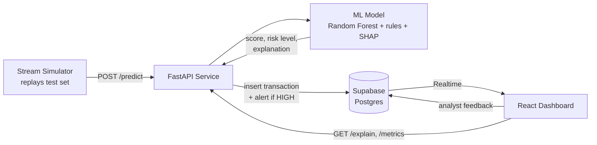

# Real-Time Fraud Detection & Risk Scoring

An end-to-end fraud detection system: machine-learning models trained on 284,807 real credit card transactions, served through a low-latency FastAPI service, fed by a real-time transaction stream, stored in Supabase, and monitored from a live React analyst dashboard. Every transaction gets a fraud probability, a LOW / MEDIUM / HIGH risk level, and a SHAP explanation of *why* — and analysts can review alerts and send feedback, just like in a production fraud operations team.

> 🚧 **Status:** in development. Results and setup instructions will be filled in as each phase is completed.

## Features

**Machine learning**
- Time-based train / validation / test split (no data leakage from the future)
- Four models compared: Logistic Regression, Decision Tree, Random Forest, XGBoost
- Three imbalance strategies compared: class weights, SMOTE, undersampling (fraud is only 0.17% of data)
- Evaluated with metrics that matter for rare events: PR-AUC, precision, recall, F1, recall at 90% precision, and dollars saved — not accuracy
- Cost-based decision threshold (missed fraud vs. analyst review cost)
- Calibrated probabilities
- Per-transaction SHAP explanations

**API**
- FastAPI endpoints: `/predict`, `/predict/batch`, `/explain`, `/health`, `/metrics` (p50/p95/p99 latency); `/explain/{id}` arrives with Supabase in Phase 4
- Hybrid scoring: ML model + a small rules layer
- LOW / MEDIUM / HIGH risk levels; HIGH risk automatically raises an alert

**Real-time pipeline**
- Stream simulator replays held-out transactions at a configurable rate (e.g. 20/sec)
- Every scored transaction stored in Supabase Postgres
- Supabase Realtime pushes new transactions and alerts to the dashboard instantly

**Analyst dashboard**
- Live transaction feed
- Alert review queue — mark as confirmed fraud or false alarm (feedback loop)
- Model comparison page with precision-recall curves
- Transaction detail view with SHAP feature-contribution bars
- Secure analyst login (Supabase Auth + Row Level Security)

**Production-ready**
- pytest test suite, Docker Compose, GitHub Actions CI
- Drift monitoring (live score distribution vs. training)
- Deployed API (Render) and dashboard (Vercel)

## Architecture



## Tech stack

| Layer | Technologies |
|---|---|
| Machine learning | Python 3.13, pandas, scikit-learn, XGBoost, imbalanced-learn, SHAP |
| API | FastAPI, pytest |
| Database & auth | Supabase (Postgres, Realtime, Auth, Row Level Security) |
| Frontend | React, Vite, TypeScript, Tailwind CSS, Recharts |
| DevOps | Docker Compose, GitHub Actions, Render, Vercel |

## Folder structure

```
.
├── data/          # Kaggle dataset (not committed)
├── ml/            # EDA notebook and training pipeline
│   └── artifacts/ # trained model, threshold, metrics, PR curves
├── api/           # FastAPI scoring service
├── simulator/     # real-time transaction stream replayer
├── web/           # React analyst dashboard
├── supabase/      # SQL migrations
├── tests/         # pytest test suite
└── docs/          # extra documentation and screenshots
```

## Dataset

[Kaggle — Credit Card Fraud Detection (ULB)](https://www.kaggle.com/datasets/mlg-ulb/creditcardfraud): 284,807 European card transactions over two days, 492 of them fraudulent (0.17%). Features `V1`–`V28` are anonymized PCA components; `Time` and `Amount` are raw. Because the features are anonymized, the "real-time" stream is a replay of the held-out test period.

> Why not accuracy? A model that predicts "not fraud" for everything scores **99.83% accuracy** and catches zero fraud. This project reports PR-AUC, recall at fixed precision, and cost saved instead.

## Results

Full write-up: [`docs/model_results.md`](docs/model_results.md). Every choice (model, imbalance strategy, hyperparameters, calibration, threshold) was made on the validation set. The test set was scored **once** per model version (it was re-scored once more after fixing a calibration bug, not to tune anything; see the write-up).

**Final model: Random Forest + class weights, isotonic calibration. Held-out test set** (42,721 transactions, 52 frauds; threshold 0.429, chosen by business cost on validation; 95% bootstrap CIs):

| PR-AUC | Precision | Recall | F1 | Recall @ 90% precision | Fraud $ caught | Cost saved* |
|---|---|---|---|---|---|---|
| **0.744** (0.62–0.86) | **0.812** (0.68–0.91) | **0.750** (0.63–0.86) | **0.780** (0.68–0.86) | **0.712** (0.56–0.84) | **61.5%** (30–93%) | **$3,556** of $6,169 ($1.1k–$7.2k) |

\*Cost = missed fraud dollars + $5 per analyst review, compared with having no model. On test: 48 alerts, 39 real frauds caught, 9 false alarms, 13 frauds missed.

**Model comparison: validation set** (best imbalance strategy and hyperparameters for each model):

| Model | Best imbalance strategy | PR-AUC | Recall @ 90% precision |
|---|---|---|---|
| **Random Forest** ⭐ | Class weights | **0.880** | 0.80 |
| XGBoost | None | 0.864 | 0.82 |
| Logistic Regression | Class weights | 0.815 | 0.66 |
| Decision Tree | None | 0.778 | 0.71 |

SHAP sanity check passed: V17, V14, V12 and V10, the strongest fraud signals in the EDA, are all among the model's top 10 features. Caveat: the validation and test periods contain no night hours, so night-time performance is untested (see the write-up).

**API latency** (1,000 test rows over HTTP on localhost, Apple M2): `/predict` p50 **6.6 ms**, p95 **7.0 ms**, p99 **8.0 ms**; a 1,000-row `/predict/batch` takes **34 ms**. Details in [API → Benchmark](#benchmark).

## API

A FastAPI service in [`api/`](api/) that loads `ml/artifacts/model.joblib` once at startup and scores transactions in a few milliseconds.

### Run it

```bash
source .venv/bin/activate
uvicorn api.main:app --no-access-log          # add --reload while developing
# interactive docs: http://localhost:8000/docs
```

`--no-access-log` turns off uvicorn's plain-text access lines; the API writes its own structured JSON line for every request (see [Logging](#logging)). Settings come from `.env` (see `.env.example`): `MODEL_PATH`, `METADATA_PATH`, `MEDIUM_THRESHOLD` (default 0.05), `MAX_BATCH_SIZE` (default 1000), `LOG_LEVEL`.

| Method | Path | What it does |
|---|---|---|
| GET | `/health` | Is the model loaded, and which version |
| POST | `/predict` | Score one transaction: probability, risk level, reasons |
| POST | `/predict/batch` | Score 1–1,000 transactions in one vectorized model call |
| POST | `/explain` | Score + top 5 SHAP feature contributions in plain words |
| GET | `/metrics` | Request counts, p50/p95/p99 latency, errors, risk-level counts, uptime |

A transaction is one row of `creditcard.csv` without `Class`: `Time`, `V1`–`V28`, `Amount` (all numbers; `Time` and `Amount` ≥ 0; unknown fields are rejected). The examples below use [`docs/examples/transaction.json`](docs/examples/transaction.json), a real fraud from the validation period.

### Risk levels

| Level | Rule |
|---|---|
| **HIGH** | Model probability **≥ 0.429**: the cost-optimal threshold tuned on validation in Phase 2 (`metadata.json["threshold"]`). Only the model can produce HIGH. |
| **MEDIUM** | Probability ≥ **0.05**, *or* a LOW transaction that trips **both** rules below |
| **LOW** | Everything else |

**Why 0.05 for MEDIUM?** The calibrated scores are step-like, so the cut was read off the validation set: at ≥ 0.05 there are 18 extra transactions (0.04% of traffic) holding 4 of the 11 frauds HIGH misses, a 22% fraud rate. Going down to 0.01 would add 177 more rows for just 2 more frauds.

**Rules layer** (from the [EDA](docs/eda_findings.md)). Rules always add a reason code; they can raise LOW to MEDIUM only when both fire, and never create HIGH:

| Code | Fires when | Why |
|---|---|---|
| `TINY_AMOUNT` | `Amount` < $1.00 | 5.5% of frauds are $0.00 "card testing" charges vs 0.6% of normal ones (finding 4) |
| `NIGHT_HOURS` | hour of day in [01:00, 07:00) | fraud rate is 1.0–1.7% at night vs ~0.1–0.2% by day (finding 5) |
| `RULES_ESCALATED` | both of the above on a LOW transaction | raises it to MEDIUM |

Model reasons are `MODEL_HIGH_RISK` and `MODEL_MEDIUM_RISK`. On the validation set: LOW 42,654 (7 frauds), MEDIUM 18 (4), HIGH 50 (45). Honest caveats: the model already sees amount and hour, so the rules mostly explain rather than add signal; and validation/test contain no night hours, so on validation `NIGHT_HOURS` never fires. On the training period (which has nights) the escalation rule would add about 0.6% of traffic to MEDIUM at a 0.95% fraud rate.

### Endpoints

**`GET /health`**

```bash
curl localhost:8000/health
```
```json
{"status": "ok", "model_loaded": true, "model_version": "1.0.0",
 "model_name": "random_forest", "trained_at": "2026-10-11T09:02:03+00:00"}
```
Returns 503 `{"status": "unavailable", "model_loaded": false}` until the model has loaded.

**`POST /predict`**

```bash
curl -X POST localhost:8000/predict \
  -H "Content-Type: application/json" \
  -d @docs/examples/transaction.json
```
```json
{
  "probability": 0.9257142857142857,
  "risk_level": "HIGH",
  "reasons": [
    {"code": "MODEL_HIGH_RISK",
     "message": "Model fraud probability 0.926 is at or above the HIGH threshold 0.429"}
  ],
  "model_version": "1.0.0",
  "latency_ms": 5.893
}
```
`latency_ms` is server-side time for this request (the first request after startup is slower, ~20 ms). A $0.00 charge at 03:00 that the model rates LOW (0.0001) instead comes back `MEDIUM` with reasons `TINY_AMOUNT`, `NIGHT_HOURS`, `RULES_ESCALATED`.

**`POST /predict/batch`**: up to `MAX_BATCH_SIZE` (1,000) rows, scored in one model call; results come back in input order.

```bash
curl -X POST localhost:8000/predict/batch \
  -H "Content-Type: application/json" \
  -d @docs/examples/batch.json            # {"transactions": [ {...}, {...} ]}
```
```json
{
  "results": [
    {"probability": 0.9257142857142857, "risk_level": "HIGH",
     "reasons": [{"code": "MODEL_HIGH_RISK", "message": "Model fraud probability 0.926 is at or above the HIGH threshold 0.429"}]},
    {"probability": 0.00013366799839598402, "risk_level": "LOW", "reasons": []}
  ],
  "count": 2,
  "model_version": "1.0.0",
  "latency_ms": 6.156
}
```

**`POST /explain`**: the `/predict` response plus the 5 inputs that moved the score most (SHAP). `log_amount` is reported as `Amount` and the two hour features as `time_of_day`. "Typical" compares the value with the training data (within 1 standard deviation = close to typical, beyond 2 = much higher/lower).

```bash
curl -X POST localhost:8000/explain \
  -H "Content-Type: application/json" \
  -d @docs/examples/transaction.json
```
```json
{
  "probability": 0.9257142857142857,
  "risk_level": "HIGH",
  "reasons": [{"code": "MODEL_HIGH_RISK", "message": "Model fraud probability 0.926 is at or above the HIGH threshold 0.429"}],
  "model_version": "1.0.0",
  "latency_ms": 11.829,
  "model_score": 0.7388427961002015,
  "base_value": 0.4999999999999627,
  "top_features": [
    {"feature": "V14", "value": -4.799737, "shap_value": 0.1343, "direction": "raises_risk",
     "description": "V14 = -4.80 (much lower than typical) pushed fraud risk up"},
    {"feature": "V10", "value": -3.739659, "shap_value": 0.1021, "direction": "raises_risk",
     "description": "V10 = -3.74 (much lower than typical) pushed fraud risk up"},
    {"feature": "V17", "value": -3.166955, "shap_value": 0.0886, "direction": "raises_risk",
     "description": "V17 = -3.17 (much lower than typical) pushed fraud risk up"},
    {"feature": "V12", "value": -2.844449, "shap_value": 0.0756, "direction": "raises_risk",
     "description": "V12 = -2.84 (much lower than typical) pushed fraud risk up"},
    {"feature": "V7", "value": 1.017732, "shap_value": -0.0648, "direction": "lowers_risk",
     "description": "V7 = 1.02 (close to typical) pushed fraud risk down"}
  ]
}
```
SHAP explains `model_score`, the forest's uncalibrated score (`base_value` + all SHAP values = `model_score`). `probability` is a monotonic calibration of that score, so the features that push one up push the other up too. shap_values are rounded here for readability.

**`GET /metrics`**

```bash
curl localhost:8000/metrics
```
```json
{
  "uptime_seconds": 0.527,
  "started_at": "2026-10-11T10:05:59+00:00",
  "requests": {"total": 8, "by_endpoint": {"GET /health": 2, "POST /explain": 1, "POST /predict": 3,
                                           "POST /predict/batch": 1, "unmatched": 1}},
  "errors": {"total": 2, "by_status": {"404": 1, "422": 1}},
  "latency_ms": {"count": 8, "p50": 4.077, "p95": 18.082, "p99": 20.464, "window": 10000,
                 "by_endpoint": {"POST /predict": {"count": 3, "p50": 7.155, "p95": 19.669, "p99": 20.781}, "...": {}}},
  "risk_levels": {"LOW": 1, "MEDIUM": 0, "HIGH": 3},
  "scope": "in-memory, per worker process, reset on restart"
}
```
Latency percentiles cover the most recent 10,000 requests. `risk_levels` counts transactions scored by `/predict` and `/predict/batch` (not `/explain`). These numbers live in memory: they reset on restart, and each uvicorn worker reports its own.

### Errors

Every error has the same shape, and `request_id` matches the `X-Request-ID` response header and the server log line:

```json
{"error": {"code": "validation_error", "message": "Request body failed validation",
           "request_id": "edf4bf301f4e42a3a4424b99b970ba4e",
           "details": [{"loc": ["body", "Amount"],
                        "message": "Input should be greater than or equal to 0",
                        "type": "greater_than_equal"}]}}
```

| Status | `code` | When |
|---|---|---|
| 422 | `validation_error` | Missing/extra field, wrong type, negative amount, NaN, malformed JSON, batch empty or over 1,000. `details` names each bad field but never echoes the submitted values. |
| 404 | `not_found` | Unknown path |
| 405 | `method_not_allowed` | e.g. `GET /predict` |
| 503 | `service_unavailable` | Model not loaded yet |
| 500 | `internal_error` | Unexpected bug: the client only gets "Internal server error"; the stack trace goes to the server log under the same request ID |

### Logging

One JSON line per request on stderr, with a request ID (send your own `X-Request-ID` to trace a call end to end, or one is generated). Transaction values are never logged: only an allow-list of fields is written.

```json
{"ts": "2026-10-11T10:06:57.325+00:00", "level": "INFO", "logger": "api", "message": "request",
 "request_id": "demo-123", "method": "POST", "endpoint": "POST /predict", "path": "/predict",
 "status": 200, "latency_ms": 6.47, "risk_level": "HIGH"}
```
4xx responses log at WARNING (with `error_code` and the names of invalid fields), 5xx at ERROR with the traceback.

### Benchmark

[`scripts/benchmark_api.py`](scripts/benchmark_api.py) starts uvicorn, then sends the first 1,000 **test-split** rows to `/predict` one at a time over one keep-alive HTTP connection (like the stream simulator will), and posts the same 1,000 rows to `/predict/batch` 20 times. Needs `data/creditcard.csv`.

```bash
python scripts/benchmark_api.py              # or --url http://localhost:8000 for a running server
```

Apple M2, Python 3.13, localhost, single uvicorn worker:

| | p50 | p95 | p99 | Throughput |
|---|---|---|---|---|
| `/predict`, round-trip (1,000 sequential requests) | 6.57 ms | 7.04 ms | 7.96 ms | 149 requests/s from one client |
| `/predict`, server-side | 5.62 ms | 6.00 ms | 6.97 ms | |
| `/predict/batch`, 1,000 rows, round-trip | 33.7 ms | 34.3 ms | 34.4 ms | ~29,700 rows/s |
| `/predict/batch`, 1,000 rows, server-side | 15.7 ms | 16.1 ms | 16.1 ms | |

`/explain` adds about 6 ms of SHAP on top of scoring (p50 11.6 ms server-side). Most of the gap between server-side and round-trip on the batch is parsing and validating 1,000 JSON rows. One design choice behind these numbers: the forest was saved with `n_jobs=-1`, and starting a thread pool for a single row cost ~10 ms, so the API scores with one thread (same predictions, `/predict` went from 15 ms to 6 ms).

## How to run

*Placeholder — detailed steps will be added as each component is built.*

1. **Clone the repo** and download `creditcard.csv` from Kaggle into `data/`.
2. **Set up Python:** create a Python 3.13 virtual environment and install `requirements.txt` (on macOS, XGBoost also needs `brew install libomp`).
3. **Configure secrets:** copy `.env.example` to `.env` and fill in your Supabase keys.
4. **Train models:** `python -m ml.train` (about 6–10 min on a laptop; add `--review-cost 10` to change the cost of one analyst review, or `--quick` for a 1-minute smoke run). It writes the model, threshold and metrics to `ml/artifacts/` and charts to `docs/figures/`. See [`docs/model_results.md`](docs/model_results.md).
5. **Start the API:** `uvicorn api.main:app --no-access-log` (see [API](#api)).
6. **Apply database migrations:** run the SQL in `supabase/` against your Supabase project.
7. **Start the dashboard:** install and run the React app in `web/`.
8. **Start the stream:** run the simulator to replay transactions at e.g. 20/sec.
9. **Or run everything with Docker Compose** *(Phase 7)*.

## Roadmap

- [x] Phase 0 — Setup
- [x] Phase 1 — Exploratory data analysis
- [x] Phase 2 — Training pipeline & model comparison
- [x] Phase 3 — FastAPI service
- [ ] Phase 4 — Supabase integration
- [ ] Phase 5 — Stream simulator
- [ ] Phase 6 — React dashboard
- [ ] Phase 7 — Docker, CI, deployment
