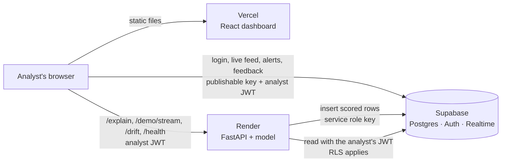

# Deployment: Supabase + Render + Vercel

This guide puts the whole system online on free plans:

| Piece | Where | Config in this repo |
|---|---|---|
| Database, auth, realtime | **Supabase** (hosted Postgres) | [`supabase/migrations/`](../supabase/migrations/) |
| Scoring API (FastAPI) | **Render**, Docker web service, free plan | [`Dockerfile`](../Dockerfile), [`render.yaml`](../render.yaml) |
| Analyst dashboard (React) | **Vercel**, static site | [`web/vercel.json`](../web/vercel.json) |



Do the steps **in this order**: the API needs Supabase's keys, the dashboard needs the API's URL, and the API's CORS setting needs the dashboard's URL.

Time needed: about 30 minutes, most of it waiting for the first Render build.

---

## 1. Supabase

If you already ran the project locally against a Supabase project, reuse it and skip to **1.3**.

### 1.1 Create the project and the schema

Follow the README's [Database → Set up your own project](../README.md#set-up-your-own-project) steps 1–5:

1. Create a project at [supabase.com](https://supabase.com).
2. Apply the three migrations in `supabase/migrations/` in filename order (SQL editor, or `supabase db push`).
3. Run `supabase/tests/rls_checks.sql` in the SQL editor: it must print `ALL RLS CHECKS PASSED`.
4. **Authentication → Sign In / Providers → Email:** keep Email on, turn **off** "Allow new users to sign up". Then **Authentication → Users → Add user** for each analyst (tick "Auto Confirm User").
5. Load the model's results for the Model & System page: `python scripts/load_model_runs.py`.

### 1.2 Copy the keys

From **Project Settings → API** (or **API Keys**):

| Value | Used by | Notes |
|---|---|---|
| Project URL, e.g. `https://abcd.supabase.co` | API and dashboard | |
| Publishable key (`sb_publishable_…`) or legacy **anon** key | API (`SUPABASE_ANON_KEY`) and dashboard (`VITE_SUPABASE_PUBLISHABLE_KEY`) | Safe in the browser: RLS limits what it can do |
| Secret key (`sb_secret_…`) or legacy **service_role** key | **API only** (`SUPABASE_SERVICE_ROLE_KEY`) | Bypasses RLS. Never put it in Vercel or anything under `web/` (a web test fails if it appears there) |

### 1.3 Site URL (after step 3)

Once you know the Vercel URL, set **Authentication → URL Configuration → Site URL** to it. Password login works without this, but Supabase uses it in any auth emails.

---

## 2. Render: the API

### 2.1 Create the service from the Blueprint

1. Sign in at [render.com](https://render.com) with GitHub.
2. **New → Blueprint**, pick this repository, branch `main`. Render reads [`render.yaml`](../render.yaml) and proposes one service, **fraud-detection-api** (Docker, free plan, health check `/health`).
3. Render asks for the values marked `sync: false`:

| Variable | Value |
|---|---|
| `SUPABASE_URL` | Project URL from 1.2 |
| `SUPABASE_ANON_KEY` | Publishable / anon key |
| `SUPABASE_SERVICE_ROLE_KEY` | Secret / service_role key |
| `CORS_ORIGINS` | Leave as `https://placeholder.invalid` for now; you set the real value in step 4 |

4. **Apply**. The first build installs the scientific Python stack and takes about 5–10 minutes. `PORT` is set by Render; the image's start command reads it.

Optional settings (Environment tab, defaults in brackets): `LOG_LEVEL` (`INFO`), `MEDIUM_THRESHOLD` (`0.05`), `DEMO_MAX_ROWS` (`200`), `DEMO_RATE_PER_S` (`10`), `DEMO_COOLDOWN_S` (`60`), `DEMO_MAX_PER_HOUR` (`12`), `DRIFT_WINDOW` (`1000`), `DRIFT_MIN_ROWS` (`500`). See [`.env.example`](../.env.example).

### 2.2 Check it

```bash
API=https://fraud-detection-api.onrender.com   # your service URL
curl $API/health
# {"status":"ok","model_loaded":true,"model_version":"1.0.0",...}
curl -X POST $API/predict -H "Content-Type: application/json" -d @docs/examples/transaction.json
# {"probability":0.9257...,"risk_level":"HIGH",...,"transaction_id":"..."}   <- a real row is now in Supabase
```

Interactive docs: `$API/docs`. The `/predict` call above stores one transaction and raises one alert; delete it in the Supabase table editor if you want a clean start (deleting the transaction removes its alert).

### 2.3 Things to know about the free plan

- **It sleeps after 15 minutes without traffic** and takes about a minute to wake on the next request. The dashboard handles this: it pings `/health` as soon as the page opens and shows *"API is waking up (free tier, ~1 min)"* until the API answers.
- **512 MB of memory.** The image only contains the API's runtime dependencies ([`requirements-api.txt`](../requirements-api.txt), CPU-only XGBoost), which fits.
- **One worker, on purpose.** `/metrics` and the demo-stream lock live in memory; more workers would each have their own.
- Auto-deploy runs on pushes to `main` that touch the image (`api/`, `ml/*.py`, the model artifacts, `Dockerfile`, `requirements-api.txt`); docs and `web/` changes don't rebuild the API.

---

## 3. Vercel: the dashboard

1. Sign in at [vercel.com](https://vercel.com) with GitHub. **Add New → Project**, import this repository.
2. **Root Directory: `web`**. Vercel then finds [`web/vercel.json`](../web/vercel.json): Vite build into `dist/`, `npm ci`, and a rewrite that serves `index.html` for every path so React Router's deep links and page refreshes work.
3. **Environment Variables** (Production, and Preview if you use preview deployments):

| Variable | Value |
|---|---|
| `VITE_SUPABASE_URL` | Project URL |
| `VITE_SUPABASE_PUBLISHABLE_KEY` | Publishable / anon key (**not** the secret key) |
| `VITE_API_URL` | The Render URL, e.g. `https://fraud-detection-api.onrender.com` (no trailing slash) |

4. **Deploy.**
5. Find the **permanent address**: project **Overview → Domains**, e.g. `https://fraud-detection-indol.vercel.app`. Use this one everywhere (CORS, Supabase, sharing). The long addresses shown on each deployment (`fraud-detection-<hash>-<team>.vercel.app`) change with every deploy.
6. Open the permanent address in a private window. If Vercel asks you to log in, go to **Settings → Deployment Protection** and turn **Vercel Authentication** off (or limit it to preview deployments); otherwise visitors can't see the site. The data stays protected by Supabase login and RLS either way.

When typing `VITE_API_URL`, check the end carefully: `https://...onrender.com` with no `/`, `.` or space after it. (The dashboard strips these since a stray trailing dot once made every call return 404, but it's still worth getting right.) Add the `VITE_*` variables as plain **Config** values, not **Secret**: Vercel refuses secrets in `VITE_` variables because they end up in the browser, and these three are public by design.

Vite writes these values into the JavaScript at build time. **After changing one, redeploy** (Deployments → ⋯ → Redeploy); a running deployment never picks up new values. If any is missing, the site shows a "Configuration missing" page listing what to add.

---

## 4. Connect the two

1. **Render → your service → Environment:** set `CORS_ORIGINS` to the **permanent** Vercel address, with no trailing slash:
   ```
   https://fraud-detection-indol.vercel.app
   ```
   Several origins (a custom domain, a specific deployment's long address) are comma-separated. Saving redeploys the API. If you open a deployment's long address instead of the permanent one, the browser is blocked until that address is added too.
2. **Supabase → Authentication → URL Configuration:** Site URL = the Vercel URL (step 1.3).

---

## 5. Smoke test

| Check | Expected |
|---|---|
| Open the Vercel URL | Landing page with the animated sample stream |
| Open `<vercel-url>/app/alerts` directly, then refresh | Redirects to login, no 404 (SPA rewrite works) |
| Sign in as an analyst | Live feed loads from Supabase. If the API was asleep, the yellow "API is waking up" banner shows for up to a minute, then disappears |
| **Start demo stream** | "Streaming n / 200" for about 20 s; rows arrive live; the 4 frauds in the slice show up about 4–8 s in; MEDIUM/HIGH rows raise alerts |
| Alerts → open an alert | Details plus SHAP bars (this calls `GET /explain/{id}` across origins with your login, so it also proves CORS) |
| Confirm fraud / False alarm | The alert leaves the open queue; a `feedback` row is stored |
| Model & system | Test metrics, health "Healthy", latency chart, **Score drift** ("Not enough data" until there are 500 live scores, i.e. after a few demo streams) |
| Browser console | No CORS errors |

---

## Troubleshooting

| Symptom | Cause and fix |
|---|---|
| Console: *blocked by CORS policy* | `CORS_ORIGINS` on Render doesn't match the page's origin exactly (scheme, host, no trailing slash). Fix it and let Render redeploy |
| "Configuration missing" page | A `VITE_*` variable is missing or still a placeholder in Vercel, or you didn't redeploy after adding it |
| 404 on refresh of `/app/...` | Root Directory isn't `web`, so `vercel.json` wasn't used |
| "Can't reach the API" after 2 minutes | Most often CORS: you opened a Vercel address that isn't in `CORS_ORIGINS` (each deployment's long address is different; use the permanent one). Otherwise the Render service failed or is still building (check its Logs), or `VITE_API_URL` is wrong: it must be `https://<name>.onrender.com` exactly, then **redeploy** on Vercel |
| "Can't reach the API" says `http://localhost:8000` | `VITE_API_URL` was copied from `web/.env`. Set it to the Render URL and redeploy |
| Vercel won't save a `VITE_` variable ("Remove the public framework prefix…") | It was created as **Secret**. Delete it and add it again as **Config** |
| Visitors get a Vercel login page | Deployment Protection is on: Settings → Deployment Protection → Vercel Authentication off |
| Login works, feed shows *permission denied* | Migrations or RLS policies weren't applied (step 1.1), or the user isn't signed in |
| No **Start demo stream** button | `GET /demo/stream` returned 503: the API has no Supabase settings |
| Demo stream: "rate-limited, try again in N s" | Working as designed: one start per analyst per minute, 12 per hour in total |
| Score drift: "Drift check not available" | The API has no storage, or `ml/artifacts/score_distribution.json` was made for another model version: run `python scripts/make_score_distribution.py` and commit it |
| Explanations: "Your session has expired" | Sign out and in again (the token is refreshed on login) |
| Render build killed / out of memory | Make sure the Dockerfile (not a native Python build) is used: `runtime: docker` in `render.yaml` |
| Everything worked yesterday, now login fails | Free Supabase projects pause after a week without activity. Restore it from the Supabase dashboard |

---

## Updating

- **Code:** push to `main` (through a PR). GitHub Actions runs the tests and builds the Docker image; Render and Vercel deploy automatically.
- **New model:** run `python -m ml.train`, then `python scripts/make_score_distribution.py` (drift reference for the new version) and `python scripts/load_model_runs.py` (Model & System page). Commit the artifacts. The API refuses a drift reference made for another model version, so don't skip the second command.
- **New secret values:** change them in Render or Vercel. Render redeploys on save; Vercel needs a manual redeploy.
- **Demo data:** `python scripts/reset_demo_data.py` empties `transactions`, `alerts` and `feedback` (it asks for confirmation; `model_runs` is kept).

## Security checklist

- [ ] The secret / service_role key is set **only** on Render (and in your local `.env`), never in Vercel.
- [ ] Public sign-ups are off in Supabase; analysts are added by hand.
- [ ] `CORS_ORIGINS` lists only your dashboard's origins.
- [ ] `.env` is not committed (it's in `.gitignore`).
