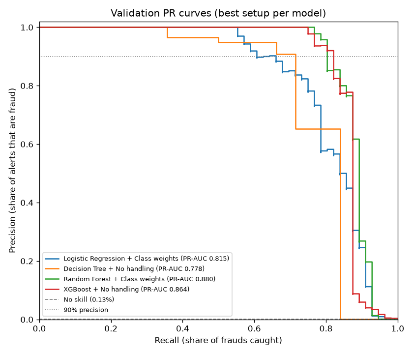
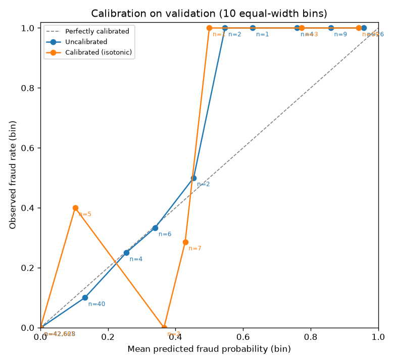
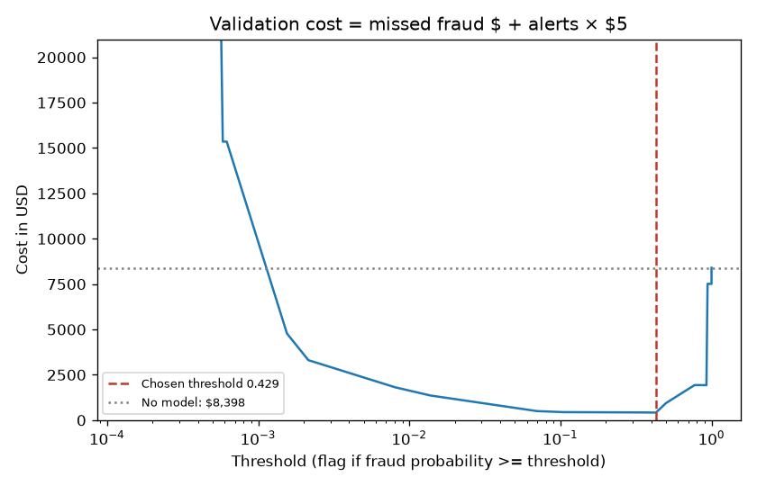
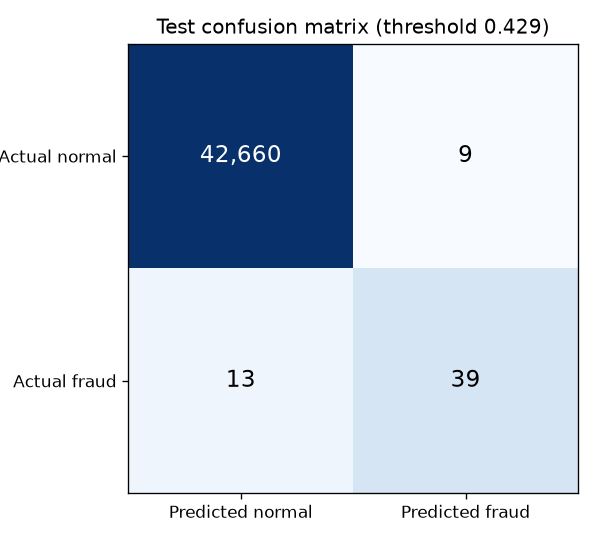
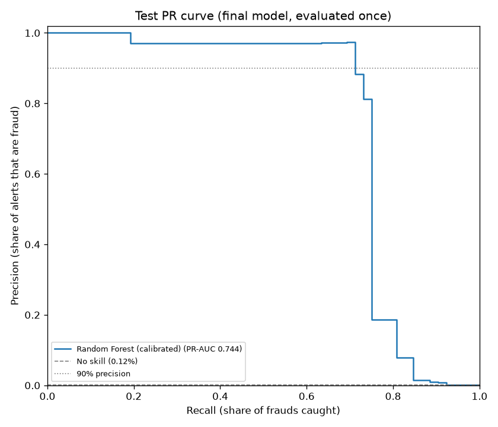
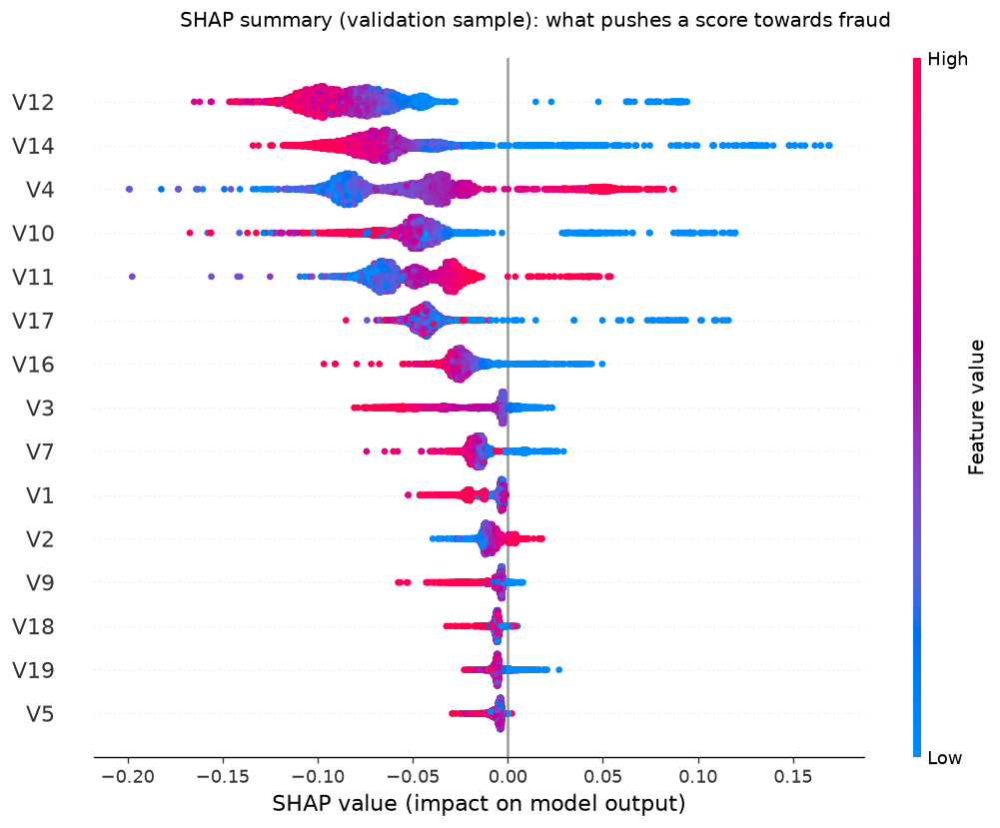
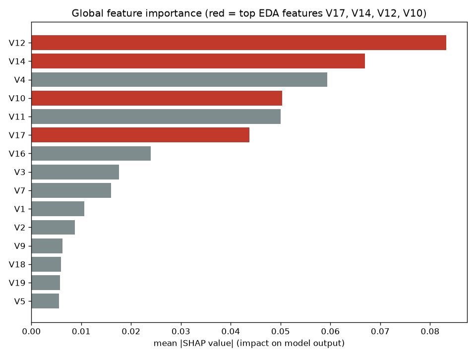

# Model results (Phase 2)

Produced by `python -m ml.train` (about 5–6 minutes on an 8-core laptop). Every number below comes from [`ml/artifacts/metadata.json`](../ml/artifacts/metadata.json) and [`ml/artifacts/model_comparison.csv`](../ml/artifacts/model_comparison.csv).

**Short version:** a **Random Forest with class weights** caught **39 of 52 frauds (75%)** in the held-out test period. **81% of its alerts were real fraud.** It saved an estimated **$3,556 out of $6,169** in fraud losses after paying $5 for each analyst review. The test set has only 52 frauds, so these numbers are uncertain: the 95% interval for recall runs from 63% to 86%.

## 1. Setup

| | Rows | Frauds | Fraud rate | Time window (s) |
|---|---:|---:|---:|---|
| Train | 199,364 | 384 | 0.193% | 0 – 132,928 |
| Validation | 42,722 | 56 | 0.131% | 132,929 – 151,328 |
| Test | 42,721 | 52 | 0.122% | 151,329 – 172,792 |

- **The split follows time** (EDA finding 10). The model learns from the past and is scored on the future, as it would be in production.
- **Features:** V1–V28; `log_amount = log1p(Amount)`; and the hour of day encoded as `hour_sin` and `hour_cos`, so 23:59 sits next to 00:00. Raw `Time` is dropped. A `StandardScaler` sits inside the model pipeline, so it only ever learns from training data.
- **Every choice was made on validation:** hyperparameters, model, imbalance strategy, calibration method and threshold. The **test set was scored once**, at the very end (and once more after the calibration bug fix described in §3).

## 2. Which model? (validation set)

16 combinations were compared: 4 models × 4 ways of handling the imbalance, each with a small hyperparameter grid (48 fits in total). They are ranked by **PR-AUC**, which summarises how well a model ranks frauds above normal transactions. 1.0 is perfect, and random guessing scores 0.0013 here.

| Model | No handling | Class weights | SMOTE | Undersampling | Recall @ 90% precision (best) |
|---|---:|---:|---:|---:|---:|
| Logistic Regression | 0.785 | **0.815** | 0.809 | 0.811 | 0.66 |
| Decision Tree | **0.778** | 0.710 | 0.716 | 0.697 | 0.71 |
| Random Forest | 0.860 | **0.880** ⭐ | 0.866 | 0.862 | 0.80 |
| XGBoost | **0.864** | 0.854 | 0.845 | 0.860 | 0.82 |

*(Each cell shows the best hyperparameters for that pair. Bold marks the best strategy per model. ⭐ is the winner.)*

What this shows:
- **Ensembles of trees win.** Random Forest and XGBoost are clearly ahead of a single tree or a linear model.
- **Imbalance handling helps some models and hurts others.** It helped Logistic Regression (+0.03 PR-AUC). It hurt the single Decision Tree, which became over-eager and flagged too much. It made little difference for Random Forest and XGBoost. "Always use SMOTE" is not a safe rule.
- **Undersampling is the fastest option.** It trains on about 4,200 rows instead of 199,000 (under 0.5 s per fit) and still comes within about 0.02 of the best result. That makes it a good option when retraining has to be cheap.
- **The gaps are small.** Random Forest (0.880) and XGBoost (0.864) differ by about one fraud's worth of ranking. With 56 validation frauds, either would be a reasonable pick. The rule was "highest validation PR-AUC", so Random Forest it is: `class_weight="balanced_subsample"`, 200 trees, `max_depth=16`, `min_samples_leaf=5`.
- **Duplicate check (EDA finding 2).** Retraining without the 716 duplicate rows in train gave a validation PR-AUC of 0.874, against 0.880 with them. Duplicates are not inflating the score, so they were kept.

## 3. Calibration: making "0.8" mean "80%"

A model's raw score is not automatically a true probability. **Calibration** fixes that, and it matters because the API will turn scores into LOW / MEDIUM / HIGH risk levels.

How it works ([`ml/calibration.py`](../ml/calibration.py)):
1. **Walk forward through the training data** (`TimeSeriesSplit`, 4 folds). Train a forest on the first 20% of the period and score the next 20%, then train on the first 40% and score the next 20%, and so on. Every one of those 159,488 "out-of-fold" scores comes from a model that never saw that row, and only ever looked at the past.
2. **Learn a score → probability map** from those scores and the true labels. Two methods were compared: sigmoid (a smooth S-curve) and isotonic (a staircase that can take any increasing shape).
3. **Put that map on top of the forest trained on the full training period.** The deployed model is exactly that forest followed by the map.

| | Brier score (lower is better) | Validation PR-AUC |
|---|---:|---:|
| Uncalibrated Random Forest | 0.000335 | 0.880 |
| Sigmoid (Platt) calibration | 0.000320 | 0.880 |
| **Isotonic calibration** (kept) | **0.000299** | 0.866 |

**Calibration helped: isotonic cut the Brier score by about 11%.** Its PR-AUC is a little lower because the staircase gives many transactions exactly the same probability (only 26 distinct values on test), so the model can no longer rank them against each other. Sigmoid keeps the ranking but improves the probabilities less. We follow the rule set in advance (lowest validation Brier), so isotonic is kept.

**A bug fix worth knowing about.** The first version used scikit-learn's `CalibratedClassifierCV` with `TimeSeriesSplit`. That quietly ships an *average of 4 forests*, each trained on only 20–80% of the training period, and not the forest we had selected. It made calibration look harmful (Brier 0.000338, PR-AUC 0.859), and it meant SHAP explained a different model from the one producing scores. The approach above fixes both problems. The test set was scored a second time after this fix. No setting was tuned on test results, but strictly speaking the test set has now been looked at twice.

## 4. Choosing the alert threshold (validation set)

The model outputs a probability, and we flag a transaction when it is at or above a threshold. To pick the threshold, we put a dollar value on each mistake:

> **cost = fraud dollars we miss + number of alerts × $5 review cost**

This is computed for every possible threshold on validation, and the cheapest one is kept.

- **Chosen threshold: 0.429.** On validation it raised 50 alerts (45 real frauds, 90% precision, 80% recall) and caught 98% of fraud dollars. It cut cost from $8,398 (no model) to $416.
- **The 90%-precision threshold** (the loosest threshold that keeps validation precision at or above 90%) **is also 0.429** this time. Isotonic calibration outputs a staircase, and the cheapest step happens to be the 90%-precision step. In Phase 3, a lower MEDIUM cut point will need to be picked separately.
- Change `--review-cost` and the threshold moves. Pricier reviews mean fewer, more confident alerts.

## 5. Final result: test set, evaluated once

| Metric | Value | 95% CI (1,000 bootstrap resamples) |
|---|---:|---|
| PR-AUC | **0.744** | 0.622 – 0.856 |
| Precision (share of alerts that are fraud) | **0.812** | 0.684 – 0.911 |
| Recall (share of frauds caught) | **0.750** | 0.632 – 0.864 |
| F1 | **0.780** | 0.682 – 0.861 |
| Recall at 90% precision | **0.712** | 0.558 – 0.839 |
| Fraud dollars caught | **61.5%** | 29.6% – 92.9% |
| Cost saved vs. no model | **$3,556** of $6,169 | $1,112 – $7,204 |

At threshold 0.429 the model raised **48 alerts on 42,721 transactions**. **39 were fraud and 9 were false alarms.** It missed **13 frauds**.

**Why did we catch 75% of frauds but only 62% of fraud dollars?** Four large frauds ($1,097, $634, $358 and $187) make up $2,276 of the $2,372 we missed. The model gave all four a probability below 0.02: to it, they look almost completely normal. No sensible threshold would have caught them. The other 9 missed frauds are all under $43, including a $0 and a $1 "card testing"-style charge. A tiny-amount rule in the Phase 3 rules layer is aimed at that pattern.

**Why is test lower than validation (PR-AUC 0.74 vs 0.87)?** There are three reasons, all expected:
- Validation was used for tuning, model choice and threshold choice, so its scores are a little optimistic.
- The test period is later in time. Fraud patterns drift, and the fraud rate is lower (0.12%).
- With 52 frauds, the test numbers are noisy: each fraud is worth about 2 points of recall.

This is the honest number to quote.

## 6. Does the model look at the right things? (SHAP)

SHAP measures how much each feature pushed each prediction towards or away from "fraud". It was computed on a validation sample (all 56 frauds plus 5,000 normal transactions) using `model.base`, the full-train forest inside the deployed model. Calibration is an increasing map applied on top of its score, so the features SHAP reports are the ones driving the served probability.

**Top 10 features:** V12, V14, V4, V10, V11, V17, V16, V3, V7, V1.

**Sanity check: passed.** The four features EDA flagged as the strongest fraud signals (V17, V14, V12 and V10; EDA finding 7) are all in the top 10, and low values of them push towards fraud, matching the EDA. V4 and V11 are the two features EDA found to be *higher* for fraud, and SHAP agrees. `log_amount` and the hour features matter much less.

## 7. Limitations (read before quoting these numbers)

1. **Validation and test contain no night hours** (EDA finding 10c). They cover only the afternoon and evening of day 2. Fraud spikes at night (EDA finding 5), so performance on night-time traffic is **untested**. The model learned night patterns in training, but we cannot show how well they work.
2. **Small numbers of fraud:** 56 validation frauds and 52 test frauds. The confidence intervals are wide, and model rankings that differ by about 0.02 PR-AUC are within noise.
3. **Validation did a lot of work.** It was used for tuning, model choice, calibration choice and threshold choice, so validation scores are optimistic. The test numbers are the honest ones, with the caveat that the test set was scored twice (before and after the calibration bug fix).
4. **The cost model is simple.** It assumes a flat $5 per review and that a caught fraud recovers its full amount. $0 frauds add no dollar cost, so the cost-based threshold ignores them.
5. **The features are anonymised PCA components.** We can say *which* component matters, but not what it means in business terms (merchant, country and so on).
6. **The data covers only two days, from 2013.** Real fraud patterns change week to week, so a production system would need regular retraining and the drift check planned for Phase 7.

## Files

- `ml/artifacts/model.joblib`: the calibrated model (`ml.calibration.CalibratedModel`), which takes raw columns `Time, V1…V28, Amount`. `model.base` is the forest used for SHAP explanations.
- `ml/artifacts/metadata.json`: thresholds, all metrics with CIs, the feature list, library versions and the split.
- `ml/artifacts/model_comparison.csv`: all 48 validation runs.
- `ml/artifacts/pr_curves.json`: validation PR-curve points for the dashboard.
- `docs/figures/`: the charts shown above.
